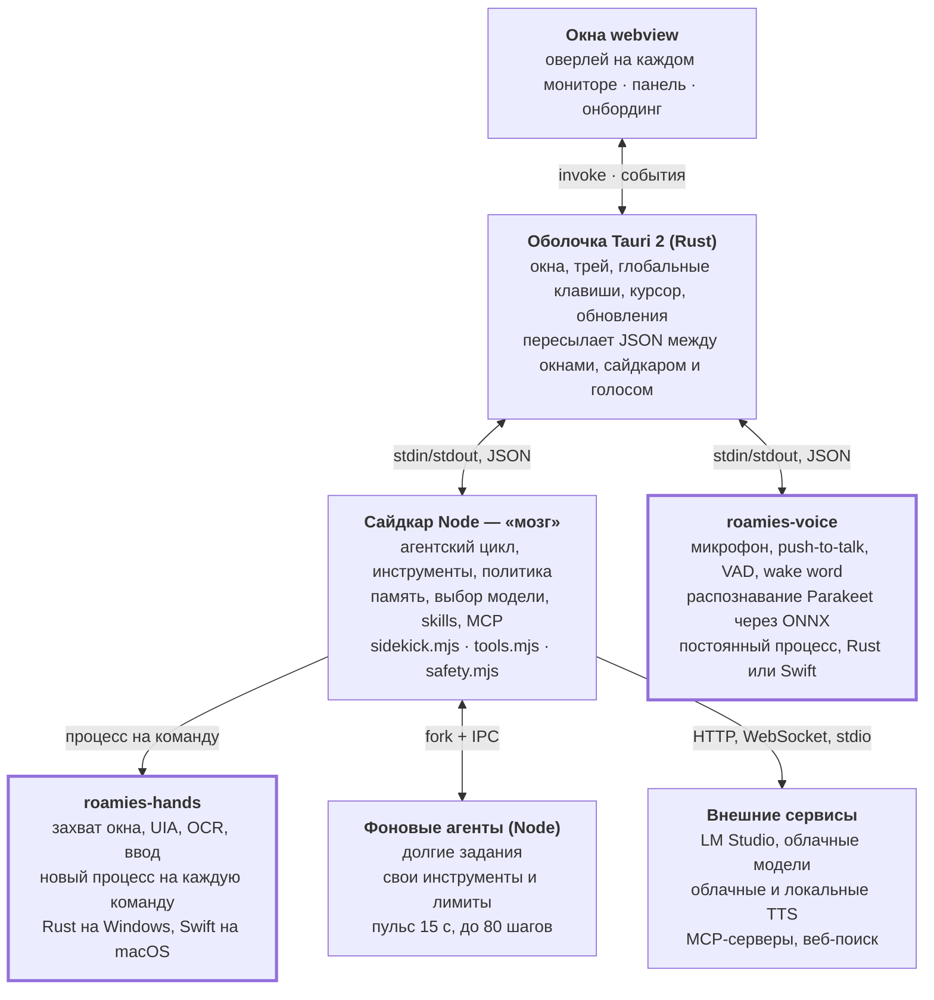
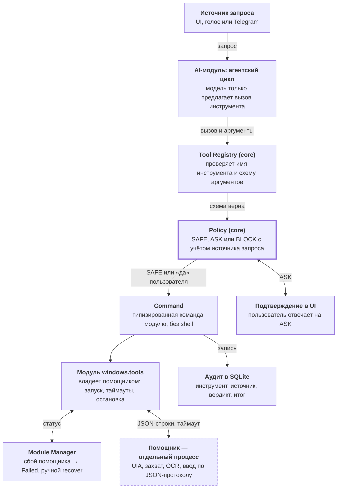

# Исследование Roamies: новые возможности для ATLAS

> **Статус документа: исследовательский материал.** Это не утверждённая архитектурная спецификация, не ADR и не решение о порядке разработки. Существующие ADR, этапы `docs/ROADMAP.md`, последовательность реализации и архитектурные решения ATLAS этим документом не меняются. Формулировки вида «принять», «стоит закрепить ADR», «нужен ADR» — рекомендации исследования для последующего рассмотрения, а не принятые решения.

- **Дата исследования:** 19 ноября 2026 г.
- **Оригинальный отчёт:** <https://claude.ai/artifact/4owaqhggPVrkrxrim9uGYZ>. Ниже — его полный текст на момент переноса в репозиторий (20 ноября 2026 г.).
- **Состояние, по которому сделаны выводы:** ATLAS `main` = `8744a0e` (после PR #38); Roamies `5672a6e` (v0.1.45, коммит от 2026-11-19 16:57 UTC).
- **Подготовлено:** Claude (Anthropic) по заданию владельца проекта.

## Статус приоритетов P0

Три приоритета P0 зафиксированы как **рекомендации для последующего архитектурного рассмотрения**:

1. Отдельные процессы-помощники для нативного кода (D-1).
2. Архитектурная цепочка Tool → Policy → Command (D-2).
3. Проверки перед вводом данных в чужие окна (C-1).

Процессы-помощники (D-1) и цепочка Tool → Policy → Command (D-2) — архитектурные решения. Каждое требует самостоятельного рассмотрения и утверждения пользователем отдельной задачей; ADR по ним, если будет решено, оформляются отдельно. C-1 опирается на политику из D-2 и рассматривается вместе с ней. В рамках добавления этого документа ADR не создавались и не менялись.

## Лицензионная оговорка

- Документ пересказывает идеи и поведение Roamies своими словами. Исходный код Roamies, его фрагменты, тексты промптов и составленные в Roamies списки в ATLAS не переносятся; AGPL-зависимости не добавляются.
- Обязательства AGPL-3.0 возникают из-за кода и текстов Roamies, а не из-за архитектурных идей. Идея, описанная своими словами и реализованная заново по собственной спецификации ATLAS, сама по себе под AGPL не подпадает (раздел 7).
- Целевая лицензия ATLAS — GPL-3.0-or-later; стратегия описана в PR #41 (`docs/LICENSING_STRATEGY.md`, на момент добавления этого документа не слит). Лицензия ещё не опубликована, файла `LICENSE` нет. Этот документ не меняет ни целевую лицензию, ни лицензионные файлы и манифесты.
- Исследование проводилось до фиксации стратегии, поэтому места, где сказано «лицензия не выбрана», дополнены примечаниями к публикации (разделы 4, 8 и 11).
- Это не юридическое заключение; итоговые лицензионные решения лучше подтвердить у специалиста.

## Изменения при переносе в репозиторий

- Две схемы оригинала (интерактивные рисунки) переданы диаграммами Mermaid с теми же блоками, подписями и связями. Цветовое выделение заменено толстой рамкой, пунктир сохранён.
- Добавлены этот вводный блок и примечания к публикации в разделах 4, 8 и 11. Текст исследования не сокращался и не переписывался.
- Документы `claude/ROADMAP_AFTER_MM4.md`, `claude/MM5B_PLAN.md`, `claude/ATLAS_ARCH_AUDIT_STAGE0-1.md` («аудит Stage 0/1»), на которые ссылается текст, — материалы проекта Claude; в репозитории их нет.

---

## Краткий ответ

ATLAS стоит перенять у Roamies пять решений, а не код. Три из них ложатся на существующие Module Manager, Event Bus и ADR без смены контрактов; два требуют новых ADR — о процессах-помощниках и о цепочке инструментов. Всего классифицировано 55 возможностей: A — 4, B — 8, C — 21, D — 11, E — 11 (сводка — в конце отчёта).

1. **Процессы-помощники для нативного и системного кода (D, P0).** STT на ONNX и управление Windows (UI Automation, захват, OCR, ввод) у Roamies работают в отдельных исполняемых файлах с JSON-протоколом. Это закрывает открытый вопрос ?-3 и ограничение ADR-014: блокирующий нативный вызов прервать нельзя, а процесс завершить можно.
2. **Цепочка Tool → Policy → Command (D, P0).** Модель только предлагает вызов, политика выносит вердикт SAFE / ASK / BLOCK, исполняет помощник. К ней — проверки Roamies: «запретные» приложения (терминалы, regedit, UAC, менеджеры паролей), отказ для процессов администратора, проверка окна перед вводом, подтверждение «опасных» кнопок.
3. **Адаптер LM Studio, знающий возможности модели (B → C, P1).** Vision, tool use и контекст брать из `/api/v1/models`, скрывать непригодные модели, держать облегчённый профиль для малых моделей и стабильный префикс промпта ради KV-кэша.
4. **Голос (B → C, P1).** Parakeet TDT 0.6B v3 (есть русский, CC-BY-4.0) через `parakeet-rs` в отдельном процессе — кандидат для Voice spike. Озвучка по предложениям во время генерации, прерывание нажатием push-to-talk.
5. **Память (B → C, P1–P2).** Сворачивание контекста, проход извлечения фактов малой моделью с журналом «что запомнено», отбор по FTS5, запрет хранить скриншоты.

**На потом (D, P2–P3):** оверлей-Orb на рабочем столе и режим «покажу, где нажать», GUI Grounding, планировщик напоминаний, Skills как данные, MCP — последний с конфликтами ADR-008 и ADR-011.

**Не брать (E):** произвольный shell от модели, автоматические перезапуски, глобальный пропуск подтверждений, облачные сервисы по умолчанию, Node-сайдкар, токены в открытом JSON и любой код Roamies — он под AGPL-3.0.

Утверждённый порядок разработки ATLAS не меняется: пять решений встраиваются в этапы 2–6 существующей дорожной карты, остальное идёт после них (раздел 11).

## Методика и источники

Выводы сделаны по исходному коду. README использован только для заявленных сценариев; такие места помечены «по данным README».

- **Roamies:** [коммит `5672a6e`](https://github.com/KenKaiii/Roamies/tree/5672a6e22c78c2268b186596dde88510c9a35751) (v0.1.45, 20.11.2026; 212 коммитов, 261 файл). Изучены оболочка Tauri (`st/src-tauri/src`), помощники `hands-win` и `voice-win`, сайдкар (`st/sidecar`, 49 модулей, ≈ 12,3 тыс. строк), интерфейс (`showcase/roamies`, `showcase/panel`), тесты (≈ 8 тыс. строк) и CI. Swift-помощники macOS — только для сверки поведения.
- **ATLAS:** [`main` = `8744a0e`](https://github.com/Inlerno/ATLAS/tree/8744a0e786265ae8c553d1fc9cbd200fc1a7fea8) (после PR #38). Код `src-tauri/src` и `src`; `CLAUDE.md`, `README.md`, `docs/ARCHITECTURE.md`, `docs/DECISIONS.md` (ADR-001…016), `docs/ROADMAP.md`, `docs/FIRST_STAGE.md`, `docs/DEVELOPMENT_LOG.md`; документы проекта (`ROADMAP_AFTER_MM4`, `MM5B_PLAN`, аудит Stage 0/1 и др.).
- **GitHub ATLAS:** открыты Issue #13 (трекер) и #21 (MM-5B), PR #39 (MM-5B, этап D); закрыто 23 PR, их история — по merge-коммитам. Текст Issue #13 прочитать не удалось: GitHub ограничил частоту запросов. Решения 1–29 из него взяты по ссылкам в ADR и документах проекта.
- **Лицензии:** `npm ci --ignore-scripts` по `package-lock.json` сайдкара (242 пакета), `cargo metadata` для трёх Rust-крейтов под `x86_64-pc-windows-msvc`, карточки моделей на Hugging Face.
- **Обозначения путей:** `st/` = `showcase/tauri/` в Roamies. Короткие имена файлов без каталога (`tools.mjs`, `act.rs`, `sidecar.rs`) и пути от `hands-win/` и `voice-win/` — тоже Roamies, из `st/sidecar/` и `st/src-tauri/`. Пути ATLAS даются от корня репозитория (`src-tauri/src/…`, `docs/…`, `CLAUDE.md`). Номера строк даны для указанных коммитов.
- **Ограничения:** ничего не запускалось на Windows; RAM и VRAM взяты из карточек моделей и README Roamies и требуют замера. В ATLAS ничего не изменено: только клонирование и чтение публичных страниц.

## 1. Краткий обзор Roamies

Roamies — настольный компаньон-агент на Tauri 2 под AGPL-3.0. Персонаж живёт у курсора, говорит голосом, ведёт обязательства и напоминания, рисует подсказки поверх экрана и по разрешению работает в чужих приложениях.

- **Возможности.** Голос (удержание Ctrl+Alt) и текст; озвучка ответов; память о пользователе и обязательствах; рисование на экране (кольцо вокруг нужной кнопки, пошаговые подсказки, карточки, диаграммы); клики и ввод в других приложениях на macOS и Windows; фоновые агенты, задания по расписанию, skills и MCP-подключения.
- **Стек.** Оболочка на Rust (`tauri =2.12.5`); «мозг» — Node.js 24, поставляемый с приложением, с агентом из фреймворка gg того же автора. Windows-помощники на Rust (`windows 0.62.2`, `parakeet-rs 0.4.3`, `cpal`), на macOS — Swift; интерфейс — чистый JS и canvas.
- **Модели.** По умолчанию облачные: вход через Claude или ChatGPT, ключи Gemini, Grok, Kimi и др. Локально — Ollama, LM Studio и любой OpenAI-совместимый сервер, если модель видит изображения, вызывает инструменты и даёт контекст от 32k (`st/sidecar/local.mjs:15–21`).
- **Голос.** STT на Windows и Linux — локальный Parakeet TDT 0.6B v3. TTS — облачный Fish Audio или Gemini либо отдельное локальное приложение VoiceStudio; встроенного локального TTS нет.
- **Зрелость.** Версия 0.1.45; CI на трёх ОС со smoke-тестом против Блокнота; ≈ 8 тыс. строк тестов сайдкара; есть внешние контрибьюторы. Установщик для Windows не подписан.
- **Лицензия.** AGPL-3.0-only у приложения и фреймворка gg; Claude Agent SDK в зависимостях — проприетарный (раздел 8).

Главное отличие от ATLAS: у Roamies нет менеджера модулей и типизированной шины. Зато всё рискованное вынесено в отдельные процессы, а проверки безопасности собраны в одном тестируемом модуле политики.

## 2. Техническая архитектура Roamies

Roamies делит приложение на процессы по уровню риска. Rust-оболочка на Tauri 2 почти не содержит логики ассистента: она держит окна и пересылает JSON-сообщения. Логика живёт в Node-сайдкаре, а всё нативное — захват экрана, UIA, ввод, микрофон, распознавание речи — вынесено в отдельные помощники с узким JSON-протоколом.

**Схема 1. Roamies: нативный код и «мозг» живут в отдельных процессах.** Процессы Roamies и каналы между ними · 7 частей.

Толстой рамкой выделен нативный код в процессах-помощниках: их сбой не роняет оболочку и сайдкар.

### Процессы

| Процесс | Что делает | Где в коде |
| --- | --- | --- |
| Оболочка Tauri 2 (Rust) | Окна, трей, оверлеи на каждом мониторе, положение курсора около 120 раз в секунду, глобальные клавиши, обновления, single-instance; пересылка сообщений | `st/src-tauri/src/main.rs`: `build_overlays` 1056, `pump_cursor` 1411, `handle_sidecar` 1706, `main` 1856 |
| Сайдкар — «мозг» (Node 24 из комплекта, `roamies-node`) | Агентский цикл на фреймворке gg, инструменты и политика, память, выбор модели, голосовой вывод, skills, MCP | `st/sidecar/sidekick.mjs` (3011 строк), `tools.mjs`, `safety.mjs`, `store.mjs`, `route.mjs`, `local.mjs`, `speaker.mjs` |
| `roamies-hands` | Захват окна, дерево UIA, OCR, ввод с проверками. Одна команда на запуск: ответ — один JSON на stdout, прогресс — строки `@{…}` | `hands-win/src/main.rs`, `act.rs`, `uia.rs`, `capture.rs`, `ocr.rs`; для macOS — `st/src-tauri/hands/main.swift` |
| `roamies-voice` | Микрофон, push-to-talk, VAD, wake word, распознавание Parakeet TDT 0.6B v3 через ONNX; работает постоянно | `voice-win/src/main.rs`, `wake.rs`, `keys.rs`, `audio.rs`; для macOS — `st/src-tauri/voice/*.swift` |
| Фоновые агенты (Node) | Долгие задания: свой набор инструментов, пульс раз в 15 с, до 80 шагов | `agents.mjs:374` (`fork`), `agentrun.mjs:53`, `agentrun.mjs:105` |
| Окна webview | Sidekick-оверлей, панель настроек, онбординг | `showcase/roamies/`, `showcase/panel/`, `showcase/onboarding/` |

### Каналы связи

- **Окна ↔ оболочка:** команды Tauri `invoke` и события (`main.rs:1872`).
- **Оболочка ↔ сайдкар:** JSON-строки через stdin и stdout (`sidecar.rs`; разбор — `handle_sidecar`, `main.rs:1706`). Меню, обновления и работу с окнами сайдкар заказывает оболочке сообщениями.
- **Оболочка ↔ `roamies-voice`:** тоже JSON-строки; результаты распознавания оболочка пересылает в сайдкар (`voice.rs:237–274`).
- **Сайдкар → `roamies-hands`:** новый процесс на каждую команду (`tools.mjs:133–136`, функция `hands` — строка 284). Протокол один для Windows и macOS: сайдкару всё равно, кто отвечает — Rust или Swift.
- **Сайдкар ↔ фоновые агенты:** `fork` с каналом IPC.
- **Сайдкар → внешние сервисы:** HTTP к LM Studio и облачным моделям, WebSocket к TTS (`fish.mjs`, `voicestudio.mjs`), stdio или HTTP к MCP-серверам.

### Данные и сбои

- Все данные — JSON-файлы в папке пользователя (`store.mjs`, `writeJson` — строка 20): настройки, до 150 фактов, обязательства и напоминания, сессии без скриншотов, до 30 заданий (`jobs.mjs:10`), до 60 skills (`skills.mjs:13`).
- Секреты MCP шифруются DPAPI через PowerShell (`secrets.mjs:95–96`); токены AI-провайдеров лежат открыто в `~/.gg/auth.json` (E-6).
- Журнал активности — по файлу на день, хранится 7 дней; вместо набранного текста пишется его длина (`sidekick.mjs:1227–1234`).
- Сбой сайдкара — перезапуск через 1, 3 и 10 с; четвёртое падение за 5 минут останавливает перезапуски и сообщает пользователю (`sidecar.rs:40`, `93–108`). Голос перезапускается до трёх раз (`voice.rs:82`). Сбой `roamies-hands` обрывает только одну команду.

**Что важно для ATLAS.** Граница процессов проведена по риску: всё, что может упасть или зависнуть в нативном коде, отделено узким JSON-протоколом, и один протокол реализован на двух языках. Это прямой ответ на открытый вопрос ATLAS ?-3 (D-1). Node-«мозг» ATLAS не нужен — эту роль играет Rust-ядро (E-5); автоматические перезапуски противоречат ADR-014 (E-2).

## 3. Наиболее интересные реализации

Самое ценное у Roamies — не набор функций, а то, как они защищены и изолированы. Ниже — по направлениям задания, с местом в коде и принципом работы.

### A. Персонаж, окна и трей

- **Оверлей на каждом мониторе.** Прозрачное окно без рамки, поверх всех, вне панели задач и без фокуса. Клики проходят насквозь, пока курсор не над «горячей» областью: страница вызывает `set_hot`, оболочка переключает `set_ignore_cursor_events` (`st/src-tauri/src/main.rs:254`; `build_overlays` — 1056–1124).
- **Курсор из Rust.** Оболочка примерно 120 раз в секунду передаёт координаты курсора в каждый оверлей (`pump_cursor`, `main.rs:1411`).
- **Невидимость для своих скриншотов.** На Windows оверлей исключён из захвата экрана через `SetWindowDisplayAffinity(WDA_EXCLUDEFROMCAPTURE)` (`exclude_from_capture`, `main.rs:241`).
- **Анимация.** Процедурная LED- и пиксель-графика на canvas; тело реагирует на уровень голоса и состояние «думает / говорит / слушает» (`showcase/roamies/10-dither.js`, `jarvis.js`, `people.js`; уровень — `voice-out.js`).
- **Трей и панель.** Левый клик по значку открывает окно-панель со страницами Home, Memory, Abilities, Model, Appearance, Speaking, Listening, Shortcuts, General (`showcase/panel/index.html:35–45`). Значения хранит сайдкар, панель только показывает и отправляет действия.
- **Клавиши.** Глобальные сочетания «показать/скрыть», «спросить об области», «список». Esc перехватывается, только пока персонаж на экране (`set_esc`, `st/src-tauri/src/voice.rs:199`). Второй запуск с `--talk`, `--ask`, `--panel` передаёт команду работающему экземпляру (`main.rs:1833–1854`).
- **Окна чата нет.** Ответы — в «пузырях» у курсора и карточках; история хранится в файлах сессий.

### B. Computer use и управление Windows

- **Отдельный помощник `roamies-hands.exe`.** Одна команда — один запуск; результат — JSON в stdout, ход выполнения — строки `@{…}` в stderr. Команды: `windows`, `front`, `capture`, `ui`, `find-text`, `ocr-find`, `refine`, `act` и др. (`st/src-tauri/hands-win/src/main.rs:1–21`).
- **Агент и система разделены.** Модель видит инструменты `read_window`, `act_in_app`, `take_screenshot`, `draw`; их реализация вызывает помощник с типизированными аргументами (`hands()` в `st/sidecar/tools.mjs:284`). Процессы ОС модель напрямую не запускает — кроме `run_command` (см. E-1 в разделе 5).
- **`act` — план шагов.** `focus`, `click`, `set`, `press_button`, `click_text`, `type`, `fill`, `choose`, `scroll`, `key`, `click_at`, `wait`. Сначала — паттерны UI Automation без курсора. Реальные курсор и клавиатура берутся «взаймы»: событие `borrow`, ожидание бездействия пользователя до 8 с через `GetLastInputInfo`, затем возврат курсора и окна (`act.rs:122` `take_real`, `150` `give_back`).
- **Проверки на каждом шаге.** Приложения из списка `hands_off` (cmd, PowerShell, Windows Terminal, WSL, regedit, mmc, Диспетчер задач, Параметры, UAC, «Безопасность Windows», менеджеры паролей, Visual Studio) можно только показывать, но не кликать и не печатать (`logic.rs:118–145`; `act.rs:926`, `964`). Процесс администратора — отказ: Windows всё равно отбросит ввод (`win.rs:201`, `act.rs:929`). Перед вводом окно-цель должно быть впереди, иначе остановка (`act.rs:979–988`).
- **«Опасные» кнопки.** Подписи вроде delete, pay, send, sign out на десятке языков и на CJK требуют флага `confirmed` от сайдкара (`logic.rs:281–330`, `st/sidecar/safety.mjs:80`). Одно «Разрешить» действует на один вид действия в одном приложении до конца запроса (`tools.mjs:262`). Русских слов в списке нет.
- **Экономия шагов модели.** После изменяющего шага помощник сразу отдаёт новое дерево контролов и текст окна (`act.rs:999–1006`).
- **Захват и OCR.** `PrintWindow(PW_RENDERFULLCONTENT)` с резервом через снимок экрана (`capture.rs:88–91`); OCR — встроенный `Windows.Media.Ocr`, нужен языковой пакет с OCR (`ocr.rs:24`).
- **Тесты.** `--self-test` логики на любой ОС и `--smoke` против настоящего Блокнота в Windows CI: найти окно, заполнить поле, прочитать, распознать, отказать в терминале (`main.rs:265–362`, `.github/workflows/ci.yml`).

### C. Голос

- **Отдельный процесс `roamies-voice`.** Микрофон (`cpal`), аккорд клавиш опросом `GetAsyncKeyState` без хуков и разрешений, STT — Parakeet TDT 0.6B v3 int8 ONNX через `parakeet-rs`; половина ядер (1–8 потоков) и прогрев (`st/src-tauri/voice-win/src/main.rs:1–20`; `load_model` — 76).
- **Частичные результаты без потоковой модели.** Запись перечитывается каждые 0,8 с (`READ_EVERY`, `main.rs:151`). Тишина не распознаётся: порог около −49 dBFS и адаптивный уровень шума `NoiseFloor` (`main.rs:154`, `172–197`).
- **Режимы.** Удержание — push-to-talk; короткое нажатие — hands-free до паузы 1,5 с; сессия не длиннее 60 с (`main.rs:143–151`).
- **Wake word без отдельной модели.** Каждая фраза распознаётся Parakeet и проверяется на «Hey Roamies» или своё имя с допуском ошибок распознавания (`wake.rs:1–60`).
- **Модель скачивается при настройке.** Закреплённая ревизия на Hugging Face, SHA-256 каждого файла, докачка; около 670 МБ (`st/sidecar/voicemodel.mjs:11–20`).
- **TTS за одним интерфейсом.** Fish Audio (облако, WebSocket), Gemini TTS (облако), VoiceStudio (локальное приложение на `127.0.0.1:3900`) — классы одной формы (`speaker.mjs:85`, `fish.mjs:50`, `gemini.mjs:89`, `voicestudio.mjs:92`). С локального на платный сервис отката нет.
- **Озвучка по предложениям.** Речь начинается до конца ответа; списки, код, таблицы и ссылки вслух не читаются (`speech.mjs:1–10`; `SpeechText` — 172).
- **Прерывание.** Начало записи останавливает и ответ, и речь (`sidekick.mjs:2280`); у каждого ответа свой id, старое аудио не доиграет. Пока ассистент говорит, wake word не слушает — эхоподавления нет (`st/src-tauri/src/main.rs:1781`).

### D. Агент и модели

- **Агентский цикл.** Библиотека gg-agent в Node; второй бэкенд — Claude Code через Claude Agent SDK, инструменты Roamies отдаются ему как MCP внутри процесса (`claudecode.mjs:1–20`, `485`).
- **Провайдеры и возможности.** Для LM Studio gg-core читает `/api/v1/models`: тип `vlm` и контекст загруженного экземпляра, а поддержку инструментов считает истинной. В список попадают модели с vision и tools, контекст — от 32k (`local.mjs:15–21`).
- **Облегчённый режим для малых моделей.** 9 инструментов, история 12k токенов вместо до 120k, 6 шагов вместо 24, честный отказ на недоступное (`lite.mjs:1–6`, `sidekick.mjs:966`).
- **Маршрутизация.** Регулярные выражения без вызова модели относят запрос к computer, code, agents, draw или web. Для каждого типа — своя модель, две резервные и охлаждение после лимитов (`route.mjs:10–80`, `limits.mjs`, `effort.mjs:3`). Шаблоны только английские.
- **Промпт ради кэша.** Стабильная системная часть плюс блок `<live-state>` в последнем сообщении; раздел памяти отправляется заново только при смене хэша (`sidekick.mjs:783–880`).
- **Контекст.** Старые `read_window` сворачиваются до строки, остаются 3 последних изображения, обрезка идёт по границам запросов без разрыва пар «вызов — результат». При 75 % бюджета старые ходы сворачиваются в сводку с проверкой отпечатка (`store.mjs:107–225`).
- **Боковые вызовы.** Сводки, факты и навыки — на более дешёвой модели без инструментов, при сбое — на основной (`brain.mjs:54–75`).
- **Фоновые агенты.** Отдельные Node-процессы: IPC с пульсом, вопросами пользователю и запросом ключей, своя папка, урезанные инструменты, до 80 шагов (`agentrun.mjs`; `agents.mjs:15–26`, `374`). Команда субагентов — до 3 одновременно (`subagents.mjs:7–20`).
- **Что зависит от модели:** точность указания по скриншоту, vision, вызов инструментов, длина контекста, формат координат (Qwen3-VL и Qwen3.5 дают сетку 0–1000; это определяется по имени модели). **Что на уровне приложения:** поиск текста через UIA и OCR, уточнение рамок, проверки устаревания, политика, память, маршрутизация, сворачивание контекста.

### E. Память

- **Хранение.** JSON-файлы в `~/Roamies/Data`: запись через временный файл, `fsync` и `rename`, права 0600, повреждённый файл откладывается (`store.mjs:1–60`).
- **Сессии.** До 60 файлов; скриншоты на диск не пишутся, вместо них маркер (`store.mjs:16`, `107–119`).
- **Факты.** До 150; извлекаются отдельным проходом модели в JSON с полем `replaces` и проходят вычистку секретов и фильтр «похоже на секрет» (`brain.mjs:86–140`, `store.mjs:483–530`).
- **Отбор без векторов.** 8 новейших, затем пересечение слов с запросом и недавнее использование (`pickFacts`, `store.mjs:504`).
- **Обязательства и напоминания.** Сроки и повторы на естественном языке («every weekday at 9», «every 2 hours», не чаще 5 минут); пропущенное — одно догоняющее срабатывание (`store.mjs:255–380`, `540–562`).
- **Интерфейс.** Просмотр, поиск, «забыть», «забыть всё»; для обязательств — «готово» и «снять». Правки текста факта нет (`showcase/panel/panel.js:455–497`).
- **Синхронизация.** Через облачную папку пользователя, AES-256-GCM, ключ из парольной фразы (scrypt); только факты и обязательства (`sync.mjs:1–30`).

### F. Skills и MCP

- **Skill — текст, а не код.** Файл `SKILL.md` с именем, описанием и шагами. В контексте только индекс по строке на навык; шаги читаются инструментом `use_skill` (`skills.mjs:1–3`, `92`). До 60 навыков.
- **Установка.** Из GitHub или skills.sh: только текстовые файлы, лимиты размера, защита от выхода из папки, проверка `checkSkill` на попытки скрыть что-то от пользователя или обойти подтверждения (`skills.mjs:166–260`, `safety.mjs:515–532`).
- **Самообучение.** После успешной задачи из 5 и более вызовов без ошибок модель может сохранить навык; если пользователь возразил — не сохраняет (`brain.mjs:144–190`).
- **MCP.** Список в `~/Roamies/Data/mcp.json` в формате Claude; секреты заменяются меткой и уходят в хранилище секретов; есть импорт из Claude Desktop (`mcp.mjs:1–35`). Модель видит 4 фиксированных метаинструмента, а не инструменты каждого сервера — так не ломается кэш промпта (`mcp.mjs:191–286`).
- **Политика MCP.** Добавление всегда спрашивает; шеллы и inline-код как команда сервера запрещены; удалённые — только https и не из локальной сети (`safety.mjs:542–562`). Вызов с `readOnlyHint` — без вопроса; `destructiveHint` или «опасное» имя — вопрос, который нельзя отключить (`safety.mjs:570–575`).
- **Изоляции нет.** Локальный MCP-сервер — обычный процесс с правами пользователя.

### G. Автоматизация и задачи

- **Задания по расписанию.** До 30; повторы, пауза, «запустить сейчас»; пропущенные запуски — один догоняющий. Исполняет фоновый агент с пометкой «никто не ждёт у экрана» (`jobs.mjs:1–128`). На другие ПК не синхронизируются.
- **Ошибки.** Причина сохраняется в `lastError`; автоматических повторов нет (`markRun`, `jobs.mjs:112`).
- **Прочее.** `plan_steps` показывает шаги многошаговой задачи; focus mode отслеживает отвлечения.

### H. Безопасность

- **Один модуль политики.** `safety.mjs` — чистые функции с вердиктами SAFE / ASK / BLOCK для чтения и записи файлов (секреты, чужие данные, автозагрузка, системные папки, симлинки), команд, `open`, URL (защита от SSRF с проверкой DNS), рисования, навыков и MCP (`safety.mjs:11–575`). Правило проекта: каждое изменение — с тестом.
- **Выключатели.** «Allow File Edits & Commands» по умолчанию выключен. Режим «Skip Allow prompts» не отменяет BLOCK и вопросы с флагом `always` (`tools.mjs:328`, `mcp.mjs:197`).
- **Журналы.** Файл активности на каждый день, хранится 7 дней; набранный текст в аргументах заменяется длиной (`sidekick.mjs:1227–1234`, `safety.mjs:89–101`). В панели — человеческая лента «что делал».
- **Диагностика.** Отчёт по запросу с вычисткой ключей, токенов, e-mail, домашнего пути и имени пользователя (`diagnostics.mjs:1–35`).
- **Инъекции.** Промпт объявляет содержимое страниц, файлов, экрана, MCP, навыков и отчётов агентов информацией, а не инструкциями (`sidekick.mjs:800`).
- **Рисование без кода модели.** Модель отдаёт только структуры по zod-схеме с лимитами; оверлей их рисует и ничего не исполняет (`draw.mjs:1–4`, `9`, `120`).
- **Секреты.** DPAPI через `ProtectedData` в PowerShell, без отката на открытый текст (`secrets.mjs:1–7`, `95–96`). Но ключи и OAuth-токены AI-провайдеров лежат в `~/.gg/auth.json` (`SECURITY.md`).

## 4. Сравнение Roamies и ATLAS

ATLAS сильнее в ядре — жизненный цикл, события, хранение, IPC. Roamies далеко впереди в прикладных подсистемах, которых в ATLAS пока нет. Вывод: брать у Roamies решения для этапов 2–6, ядро ATLAS не трогать.

| Подсистема | Roamies | ATLAS сейчас (`8744a0e`) | Кто сильнее и почему |
| --- | --- | --- | --- |
| Процессы | Оболочка + Node-сайдкар + 2 нативных помощника + процессы агентов; упавший процесс перезапускается сам (`st/src-tauri/src/sidecar.rs:40`) | Один процесс; модули — задачи tokio с таймаутами (ADR-011, ADR-014) | Roamies — изоляция нативных сбоев; ATLAS — строгий жизненный цикл и только ручной `recover` |
| Модули и расширения | Менеджера модулей нет; расширения во время работы — skills (текст) и MCP (процессы) | Module Manager: граф, планы, подтверждение, `ConfigUnavailable` (ADR-012, ADR-015) | ATLAS — для собственных компонентов; Roamies — для внешних расширений |
| События | Нетипизированные JSON-сообщения через оболочку | Типизированная шина с `seq` и `Lagged` (`src-tauri/src/events/types.rs:51`, ADR-013) | ATLAS |
| Хранение | JSON-файлы с атомарной записью | SQLite, миграции, проверка режима журнала, транзакции (ADR-016, MM-5B) | ATLAS |
| IPC | `sidecar_send` с произвольным JSON | Тонкие команды, DTO, зеркало TS, тест сериализации (`src/lib/ipc.ts`) | ATLAS |
| Ошибки | Каталог кодов E10… с подсказкой «что делать» (`st/sidecar/errors.mjs`) | `ErrorDto` со стабильными кодами и безопасными текстами | Паритет; у Roamies больше подсказок пользователю |
| Интерфейс | Персонаж-оверлей, пузыри, трей-панель, рисование поверх экрана; окна чата нет | Панель модулей; Orb и чат запланированы (ADR-006) | Roamies богаче сейчас; цель ATLAS шире — полноценный чат |
| LLM | Много провайдеров, проверка vision, tools и контекста, облегчённый режим, маршрутизация | Адаптер LM Studio запланирован (ADR-004, этап 3) | Roamies — готовые приёмы для этапа 3 |
| Голос | Parakeet локально; TTS в облаке или во внешнем приложении; push-to-talk, wake word через STT | Адаптеры STT, TTS, VAD, wake-word запланированы (ADR-007); вопрос sidecar открыт (?-3) | Roamies — проверенный путь STT; локального TTS нет |
| Управление Windows | UIA, захват, OCR, ввод; плюс произвольный shell по разрешению | Только типизированные allowlisted-команды (ADR-008), этап 5 | Roamies — механика; у ATLAS строже модель угроз |
| Память | Факты, обязательства, сессии, автоизвлечение; правки фактов нет | История и долговременная память в SQLite/FTS5 с просмотром, правкой и удалением (план) | ATLAS требует больше контроля; Roamies даёт механику извлечения |
| Политика безопасности | `safety.mjs`: вердикты, тесты, выключатели | Принципы (валидация, allowlist, аудит, подтверждение) без реализации | Roamies — готовая декомпозиция проверок |
| Секреты | DPAPI для ключей TTS; токены AI в открытом `~/.gg/auth.json` | Credential Manager / DPAPI; секреты запрещены в настройках (ADR-015) | ATLAS |
| Тесты и CI | 3 ОС, smoke против Блокнота | Windows CI, мутационные проверки, ручная проверка на Windows | Оба сильны; smoke-подход пригодится на этапе 5 |
| Лицензия | AGPL-3.0-only | Не выбрана | См. раздел 8 |

> **Примечание к публикации (2026-11-20).** «Не выбрана» отражает `main` = `8744a0e` на дату исследования. После этого правообладатель предварительно утвердил целевую лицензию ATLAS — GPL-3.0-or-later (PR #41, `docs/LICENSING_STRATEGY.md`, на момент публикации не слит). Лицензия ещё не опубликована, файла `LICENSE` нет.

## 5. Новые возможности для ATLAS

Из 55 найденных возможностей 21 улучшает ATLAS без смены архитектуры (C), 11 требуют новых подсистем (D), 11 не подходят (E); остальные уже есть (A) или запланированы (B). У каждой C и D указаны приоритет и сложность: S — один issue без новых зависимостей, M — несколько issue или новая зависимость, L — новая подсистема с ADR и проверками на Windows. Где и как реализовано у Roamies — в разделе 3.

### Категория A — уже реализовано

| ID | Возможность | Где в ATLAS | Что даёт Roamies |
| --- | --- | --- | --- |
| A-1 | Изоляция сбоев компонентов и ручное восстановление | ADR-012, ADR-014, `src-tauri/src/modules/manager.rs` | Ничего лучшего: у Roamies автоперезапуски (E-2) |
| A-2 | Транзакционное хранение конфигурации | ADR-016, MM-5B, `src-tauri/src/storage/` | Ничего: у Roamies JSON-файлы |
| A-3 | Типизированные события и IPC | ADR-013, `src-tauri/src/events/`, `src-tauri/src/dto/`, `src/lib/ipc.ts` | Ничего |
| A-4 | Безопасные тексты ошибок; секреты не в настройках и журналах | `ErrorDto`, ADR-015, `src-tauri/src/modules/config.rs:33–48` | Подсказка «что делать» в тексте ошибки — мелкое улучшение в C-19 |

### Категория B — уже запланировано

| ID | Возможность | Где в планах ATLAS | Что уточняет Roamies |
| --- | --- | --- | --- |
| B-1 | Адаптер LM Studio и OpenAI-совместимых провайдеров | ADR-004; ROADMAP, этап 3; ARCHITECTURE «AI» | Профиль возможностей и облегчённый режим (C-7), управление контекстом (C-8) |
| B-2 | Адаптеры STT, TTS, VAD, wake-word | ADR-007; этап 4 | Parakeet через `parakeet-rs` — кандидат для Voice spike; один интерфейс TTS; никакого молчаливого отката в облако |
| B-3 | Политика, allowlist, подтверждение, аудит инструментов | ADR-008; CLAUDE.md «Безопасность»; ARCHITECTURE «AI», «Windows tools» | Вердикты SAFE / ASK / BLOCK как чистые функции с тестами, флаг «всегда спрашивать» (D-2, C-1, C-2) |
| B-4 | История и долговременная память в SQLite/FTS5 с просмотром, правкой и удалением | ADR-005; ARCHITECTURE «Memory»; этап 6 | Извлечение фактов (C-15), отбор (C-16), сворачивание (C-8) |
| B-5 | Orb с состояниями ассистента и чат | ADR-006; этап 2 | Анимация от уровня голоса; оверлей на рабочем столе — отдельно (D-3) |
| B-6 | Хранилище секретов ОС | ARCHITECTURE «Secrets» | Метка вместо секрета в конфиге, сам секрет — в хранилище (`st/sidecar/mcp.mjs:14`) |
| B-7 | Диагностика и безопасный экспорт | ROADMAP, этап 8 | Шаблоны вычистки ключей, e-mail, домашнего пути (`st/sidecar/diagnostics.mjs:9–35`) |
| B-8 | Установщик и обновления | ROADMAP, этап 9 | Подписанный фид `tauri-plugin-updater` и резервный канал (`AGENTS.md`; `st/src-tauri/src/main.rs:1657`) |

### Категория C — новое улучшение без смены архитектуры

**C-1. Запрет ввода в «опасных» приложениях, отказ для процессов администратора, проверка окна перед шагом — P0, S.**

- Roamies: `hands_off`, `elevated_above_me`, проверка фронтального окна (3.B). ATLAS: ADR-008 ограничивает команды, но не цели GUI-действий.
- Интеграция: список целей-исключений в политике (D-2) и повтор проверки в помощнике перед каждым шагом.
- Риски: список придётся вести; составить свой, а не копировать список Roamies (раздел 8).

**C-2. Подтверждение «опасных» действий по подписи элемента — P1, S.**

- Roamies: словарь глаголов вроде delete, pay, send, sign out; разрешение действует на один вид действия в одном приложении до конца запроса. ATLAS: подтверждение есть в принципах, способа определить «опасный» элемент нет.
- Интеграция: собственный словарь RU/EN в политике → ASK; разрешение не переживает запрос.
- Риски: ложные срабатывания и пропуски. В словаре Roamies нет русских слов — для русскоязычного интерфейса он не сработал бы.

**C-3. Устаревание наблюдений — P1, S.**

- Roamies: скриншот и список контролов действуют только в текущем запросе; после клика нужен новый скриншот; окно не должно сдвинуться (`st/sidecar/pointing.mjs:54–80`). ATLAS: нет.
- Интеграция: у каждого наблюдения — номер запроса, окно и рамка; устаревшее отклоняется с подсказкой модели.
- Риски: лишние шаги модели и время ответа.

**C-4. UIA-first ввод и протокол «занять — вернуть» — P1, M.**

- Roamies: паттерны UIA без курсора; реальный ввод — после бездействия пользователя, с возвратом курсора и окна (`act.rs:96–165`). ATLAS: нет.
- Интеграция: команды помощника `invoke`, `set_value`, `select`; событие на шине «ассистент взял управление», Orb показывает это.
- Риски: не все приложения отдают UIA; `SendInput` блокируется UIPI.

**C-5. Состояние окна после изменяющего шага — P2, S.** Помощник сразу возвращает новое дерево и текст (`act.rs:999–1006`); экономится один вызов модели на шаг. Риск: большой ответ — нужен лимит размера.

**C-6. Захват окна и встроенный OCR — P2, S.**

- Roamies: `PrintWindow(PW_RENDERFULLCONTENT)`, `Windows.Media.Ocr`, свои окна исключены из захвата (`WDA_EXCLUDEFROMCAPTURE`). ATLAS: нет.
- Интеграция: команды помощника `capture` и `ocr` без новых моделей.
- Риски: OCR нужен языковой пакет (проверить русский на целевых ПК); `WDA_EXCLUDEFROMCAPTURE` есть с Windows 10 2004.

**C-7. Профиль возможностей модели и облегчённый режим — P1, M.**

- Roamies: модели без vision и tools скрыты, при контексте меньше 32k — предупреждение; облегчённый режим — 9 инструментов, 12k истории, 6 шагов (`local.mjs:15–21`, `lite.mjs:1–6`). ATLAS: ARCHITECTURE «AI» требует model discovery и structured tool calls, аудит Stage 0/1 — проверять возможности модели; механизма нет.
- Интеграция: `ModelCapabilities { vision, tools, reasoning, context }` из LM Studio `/api/v1/models` — `capabilities.vision`, `capabilities.trained_for_tool_use`, `loaded_instances[].config.context_length`. По профилю выбираются набор инструментов и бюджет. Roamies считает tools у LM Studio всегда доступными — ATLAS может читать флаг.
- Риски: флаг не гарантирует качество вызова инструментов — нужен пробный вызов при подключении.

**C-8. Управление контекстом — P1, M.**

- Roamies: стабильный системный промпт, блок текущего состояния в последнем сообщении, память переотправляется только при изменении, сворачивание старых результатов и сводка при 75 % бюджета (`sidekick.mjs:783–880`, `store.mjs:136–225`). ATLAS: нет.
- Интеграция: в AI-модуле. Для LM Studio стабильный префикс избавляет от повторной обработки промпта: по оценке Roamies, системная часть с инструментами — около 12,6 тыс. токенов (`local.mjs:14`).
- Риски: сводка теряет детали; пары «вызов — результат» нельзя разрывать — нужен тест.

**C-9. «Содержимое — данные, не инструкции» — P1, S.**

- Roamies: правило в системном промпте и в ответах MCP-инструментов (`sidekick.mjs:800`, `mcp.mjs:259–268`). ATLAS: нет.
- Интеграция: результаты инструментов помечаются как недоверенные; политика не принимает «разрешений» из содержимого.
- Риски: промпт не гарантирует защиту — решает только политика.

**C-10. Озвучка по предложениям — P1, M.** Roamies `speech.mjs`. Интеграция: TTS-адаптер принимает поток предложений, фильтр убирает списки, код и ссылки. Риск: для русского нужны свои правила сокращений и чисел.

**C-11. Прерывание ответа (barge-in) — P1, M.**

- Roamies: начало записи останавливает ответ и речь; у ответа свой id; wake word молчит, пока ассистент говорит. ATLAS: рекомендация S8 «единая отмена» в документах проекта, не утверждена.
- Интеграция: один `CancellationToken` на ход диалога для LLM, TTS и инструментов; событие на шине.
- Риски: без эхоподавления перебить можно только клавишей.

**C-12. Push-to-talk аккордом, hands-free и базовый VAD — P1, S.** Roamies: опрос `GetAsyncKeyState`, удержание и касание, `NoiseFloor` (`voice-win/src/main.rs:133–197`, `keys.rs`). VAD по уровню сигнала — запасной адаптер рядом с нейросетевым. Риски: конфликт сочетаний с другими программами, нагрузка от опроса.

**C-13. Wake word через основную STT — P2, M.** Roamies `wake.rs`: нет отдельной модели и лицензий wake-word, но микрофон и STT работают постоянно. В ATLAS — как один из адаптеров wake-word. Риски: CPU, ложные срабатывания, нужна индикация «микрофон слушает».

**C-14. Закреплённая загрузка моделей — P1, S.** Roamies: ревизия Hugging Face, SHA-256 и докачка (`voicemodel.mjs:11–40`). В ATLAS правило «модели не в установщике» есть (CLAUDE.md), механизма нет. Интеграция: сервис загрузки с проверкой хэша и событиями прогресса. Риск: сеть — только по явному действию пользователя.

**C-15. Извлечение фактов малой моделью — P2, M.**

- Roamies: отдельный проход без инструментов, JSON с `replaces`, вычистка секретов, до 20 фактов за проход (`brain.mjs:86–140`). ATLAS: память запланирована, способ записи не решён (аудит Stage 0/1, §4.3).
- Интеграция: необязательный проход после диалога; каждая запись — в журнал «что запомнено» с правкой и отменой; выключатель.
- Риски: ложные факты; нагрузка на GPU — запускать в простое.

**C-16. Отбор фактов по FTS5 и свежести; скриншоты не хранить — P2, S.** Roamies: пересечение слов и свежесть (`store.mjs:504`), скриншоты заменяются маркером (`store.mjs:107`). В ATLAS — `bm25` FTS5 плюс недавнее использование, в духе ADR-005. Риск: морфология русского в FTS5 — нужен токенизатор или стемминг.

**C-17. Защита от SSRF — P2, S.** Roamies `checkFetch` с проверкой DNS и каждого редиректа (`safety.mjs:430–480`). В ATLAS пригодится для загрузки моделей и адресов серверов, которые вводит пользователь или предлагает модель. Риск: DNS rebinding — проверять адрес уже после соединения.

**C-18. Генеративный UI без кода модели — P1, M.** Roamies: модель отдаёт только структуры по схеме (`draw.mjs:1–4`). В ATLAS CSP = null, а чат с разметкой в планах. Интеграция: ответы — Markdown без HTML или типизированные карточки; CSP до этапа 3. Риск: рендерер сложнее.

**C-19. Лента активности, аудит с вычисткой аргументов, понятные ошибки — P2, S.** Roamies: `activity.mjs`, `redactArgs`, `errors.mjs`. В ATLAS — таблица аудита в SQLite: инструмент, источник, вердикт, подтверждение, итог, длина ввода вместо текста; лента в UI. Риск: рост базы — нужна ротация.

**C-20. Трей, single-instance, команды второго запуска — P2, S.** Roamies: `tauri-plugin-single-instance` и флаги (`main.rs:1833–1890`). В ATLAS второй экземпляр не запрещён, риск принят решением O-7 (план MM-5B). Интеграция: отдельным issue после MM-5B и только по решению пользователя; новая зависимость — ревью.

**C-21. Smoke-тест помощника против Блокнота в Windows CI — P1, S.** Roamies `hands-win/src/main.rs:265–362`. В ATLAS — вместе с первым помощником. Риск: нестабильность GUI на раннерах.

### Категория D — новая архитектурная возможность

**D-1. Процессы-помощники для нативного и системного кода — P0, L.**

- Roamies: `roamies-voice` и `roamies-hands` — отдельные исполняемые файлы; их сбой не роняет приложение. ATLAS: ADR-014 признаёт, что нативный сбой убивает процесс, а блокирующий вызов не прерывается; вопрос ?-3 открыт.
- Интеграция: ADR «Процессы-помощники». Каждый принадлежит модулю (`voice.*`, `windows.tools`); протокол JSON-строк с версией и схемой; таймаут означает завершение процесса; сбой → `Failed { Run }` и только ручной `recover`.
- Риски: задержка запуска (держать процесс живым, пока работает модуль), упаковка в установщик (`externalBin`), антивирусная эвристика на `SendInput`, совместимость версий протокола.

**D-2. Цепочка Tool → Policy → Command и источник запроса — P0, M.**

- Roamies: инструменты → `safety.mjs` → помощник. ATLAS: принцип «tool call — запрос, а не разрешение» (ARCHITECTURE «AI»), рекомендация S10 в документах проекта не утверждена.
- Интеграция: core-сервисы Tool Registry и Policy; вердикт SAFE / ASK / BLOCK с флагом `always`; ответ на ASK проверяет ядро, как планы ADR-012; источник (UI, голос, Telegram, расписание) влияет на вердикт.
- Риски: слишком строгая политика делает ассистента бесполезным — нужны тесты-сценарии.

**D-3. Оверлей-Orb на рабочем столе — P2, L.** Roamies: прозрачные окна на каждом мониторе, click-through, курсор из Rust, исключение из захвата. ATLAS: Orb внутри основного окна (ADR-006). Интеграция: необязательный модуль `ui.overlay` после этапа 2, состояние — из Rust событиями. Риски: DPI и несколько мониторов, полноэкранные игры, нагрузка, права окон в capabilities.

**D-4. Режим «покажу, где нажать» — P2, L.** Roamies: ассистент обводит нужный элемент, произносит шаг и ждёт клика пользователя (`showcase/roamies/ink.js`, инструмент `draw`). Это безопасная альтернатива автономным кликам: ассистент только читает и показывает. Интеграция: после D-3 и D-5, на read-only инструментах этапа 5. Риск: точность указания.

**D-5. GUI Grounding как подсистема — P2, L.** Roamies: текст через UIA → id контрола → OCR → координаты VLM → уточнение по пикселям и контролам (`draw.mjs:281–305`, `pointing.mjs`, `capture.rs:139`). Интеграция: сервис в модуле `windows.tools`; сначала источники без модели, VLM — последним. Риски: VRAM для VLM — около 6 ГБ у Qwen3-VL 8B и 20 ГБ у 30B-A3B при 4 битах (по данным README Roamies); формат координат нельзя угадывать по имени модели (E-10).

**D-6. Роли моделей и управление загрузкой — P2, M.** Roamies: маршрутизация по типу задачи, резервные модели, отдельная модель для сводок (`route.mjs`, `brain.mjs:12–20`). Интеграция: роли «основная», «зрение», «сводки»; загрузка и выгрузка через `/api/v1/models/load` и `/unload` с учётом VRAM; выбор — явные настройки, а не регулярки по английскому тексту. Риски: смена модели занимает секунды, две модели сразу — память GPU.

**D-7. Планировщик: напоминания, обязательства, задания — P2, M.** Roamies: повторы на естественном языке, догоняющий запуск, задания исполняет фоновый агент (`store.mjs:255–562`, `jobs.mjs`). Интеграция: core-сервис Scheduler с таблицами в SQLite; срабатывание — событие на шине; без автоповторов; задания с LLM — только read-only инструменты, ASK ждёт пользователя. Риски: сон и выход из системы (вопрос ?-4), разбор дат на русском.

**D-8. Skill System как данные — P3, M.** Roamies: `SKILL.md`, индекс в контексте, шаги по запросу, установка с проверкой (3.F). В ATLAS Module — компилируемый код (ADR-011), а Skill был бы текстом, который не добавляет прав. Интеграция: таблица навыков в SQLite, только типизированные инструменты, самообучение — только предложением с подтверждением. Риски: инъекции через текст навыка; путаница Skill и Module.

**D-9. MCP-клиент как необязательный модуль — P3, L.** Roamies: 4 метаинструмента, секреты отдельно, политика по аннотациям (3.F). В ATLAS — конфликт с ADR-008 (инструменты вне allowlist) и с духом ADR-011 (расширения во время работы); удалённые серверы — сеть. Только через новый ADR: модуль `integrations.mcp` выключен по умолчанию, каждый сервер — явное согласие, каждый вызов — ASK, кроме `readOnlyHint`, никаких действий с ОС. Риски: локальный сервер — чужой код с правами пользователя; подмена описаний инструментов.

**D-10. Изолированный рантайм фоновых агентов — P3, L.** Roamies: отдельные Node-процессы, пульс, свои инструменты, лимит шагов (`agentrun.mjs`). Агентский цикл ATLAS будет на Rust — процессная изоляция ему не нужна, нужна логическая: бюджет, набор инструментов, отмена. Риск: VRAM при параллельной работе с основной моделью.

**D-11. Синхронизация памяти между ПК — P3, M.** Roamies: облачная папка и AES-256-GCM (`sync.mjs`). В ATLAS не запланировано; не раньше стабильной памяти. Риски: конфликты версий, управление ключами.

### Категория E — не рекомендуется

| ID | Решение Roamies | Почему не подходит ATLAS |
| --- | --- | --- |
| E-1 | Произвольные команды оболочки с классификатором (`run_command`, `st/sidecar/tools.mjs:953`; `safety.mjs:364`) | ADR-008 и CLAUDE.md: никакого произвольного shell/PowerShell от модели |
| E-2 | Автоперезапуск: сайдкар через 1, 3 и 10 с (`st/src-tauri/src/sidecar.rs:40`), голос — до 3 раз (`voice.rs:82`) | ADR-012 и ADR-014: выход из `Failed` — только подтверждённый `recover` |
| E-3 | Глобальный «Skip Allow prompts» (`tools.mjs:328`) | CLAUDE.md: побочные действия проходят подтверждение |
| E-4 | Облачные сервисы по умолчанию: вход через Claude и ChatGPT, Fish Audio и Gemini TTS, внешний веб-поиск (`PRIVACY.md`) | Local-first: сеть — только явно включённые интеграции (README ATLAS, принцип 1) |
| E-5 | Node-сайдкар как «мозг», фреймворк gg (AGPL), Claude Agent SDK (проприетарный) | ADR-002: ядро на Rust; лицензии (раздел 8) |
| E-6 | Токены провайдеров в открытом `~/.gg/auth.json` | ARCHITECTURE «Secrets»: только хранилище ОС |
| E-7 | Память в JSON-файлах | ADR-005 и ADR-016: SQLite с миграциями |
| E-8 | Самообучение навыкам без явного согласия | Пользователь сам управляет компонентами; допустимо только как предложение (D-8) |
| E-9 | Перенос кода Roamies, в том числе перевод на Rust | AGPL-3.0 (раздел 8) |
| E-10 | Формат координат по имени модели (`pointScale` в gg-core) | Хрупко: переименованная модель укажет мимо; нужна явная настройка или проверка |
| E-11 | Команда субагентов на разных моделях одновременно | На одном ПК не хватит VRAM; польза не доказана |

## 6. Архитектурные улучшения

Из десяти направлений задания два стоит закрепить ADR до этапов 3–5: процессы-помощники и цепочку инструментов. Три уже есть в планах ATLAS, Roamies лишь уточняет их: провайдеры LLM, голос, память. Четыре — на потом: GUI Grounding, Skills, MCP, планировщик. Изолированный рантайм агента нужен только логически, а не как отдельный процесс.

| # | Направление | Как у Roamies | Вывод для ATLAS | ID, приоритет |
| --- | --- | --- | --- | --- |
| 1 | Слой Windows Helpers | `roamies-hands` и `roamies-voice` — отдельные процессы с JSON-протоколом; их сбой не роняет оболочку | Принять: помощник принадлежит модулю, сбой — `Failed { Run }`, восстановление вручную. Новый ADR, ответ на ?-3 | D-1, P0 |
| 2 | Изолированный AI Agent Runtime | Фоновые агенты — отдельные Node-процессы с пульсом и лимитом шагов (`agentrun.mjs`) | Процессная изоляция не нужна: агентский цикл на Rust не содержит нативного кода. Нужна логическая: бюджет шагов, свой набор инструментов, отмена | D-10, P3 |
| 3 | Разделение агента, инструментов и системных команд | Вердикты — чистые функции в `safety.mjs`, но инструменты, проверки и исполнение живут в одном процессе сайдкара; модель может вызвать shell (E-1) | Принять в строгом виде: модель предлагает, реестр проверяет, политика решает, команда исполняется в модуле (схема ниже) | D-2, P0 |
| 4 | Универсальный интерфейс LLM-провайдеров | Один интерфейс gg-ai для облака и LM Studio; поддержка инструментов принимается на веру (`local.mjs`) | Уже в планах (ADR-004). Добавить профиль возможностей и облегчённый режим | B-1 + C-7, P1 |
| 5 | Подсистема GUI Grounding | Источники по очереди: текст UIA → id контрола → OCR → координаты VLM → уточнение (`draw.mjs:281–305`) | На потом: после read-only инструментов этапа 5. VLM — последний источник, около 6–20 ГБ VRAM | D-5, P2 |
| 6 | Skill System поверх модулей | `SKILL.md` — текст: индекс в контексте, шаги по запросу, самообучение | Skill — данные, а не код, и не добавляет прав; не путать с Module (ADR-011); самообучение — только предложением | D-8, P3 |
| 7 | Поддержка MCP | 4 метаинструмента, локальные и удалённые серверы (`mcp.mjs`) | Конфликт с ADR-008 и духом ADR-011. Только новый ADR; модуль выключен по умолчанию, каждый вызов — ASK | D-9, P3 |
| 8 | Единая система голосовых провайдеров | STT — Parakeet локально; TTS — облако или VoiceStudio; озвучка по предложениям | Уже в планах (ADR-007). Добавить озвучку по предложениям, barge-in, push-to-talk; без молчаливого отката в облако | B-2 + C-10…C-13, P1 (C-13 — P2) |
| 9 | Расширенная Memory | Факты извлекает малая модель, отбор по словам и свежести, история сворачивается | Уже в планах (ADR-005, этап 6). Добавить извлечение с журналом и отбор по FTS5 | B-4 + C-15, C-16, C-8; P1–P2 |
| 10 | Фоновый планировщик задач | Напоминания, обязательства и задания с догоняющим запуском (`jobs.mjs`) | Core-сервис с таблицами в SQLite; срабатывание — событие шины; без автоповторов; задания без пользователя — только read-only | D-7, P2 |

### Предлагаемая цепочка для ATLAS

**Схема 2. Модель предлагает, политика решает, помощник исполняет.** Предлагаемая цепочка вызова инструмента в ATLAS (D-1, D-2) · 6 шагов и 4 службы. Схема — рекомендация исследования, а не утверждённая архитектура.

Толстой рамкой выделена политика — точка, где принимается решение; пунктиром — отдельный процесс.

Модель не получает доступа к ОС напрямую. Вызов, не прошедший схему, отклоняется до политики. BLOCK возвращается модели как отказ, ASK ждёт ответа пользователя, а изменяющее действие, пришедшее из Telegram, по умолчанию запрещено. Каждый итог, включая отказы, попадает в аудит. Сбой помощника переводит модуль в `Failed { Run }`, перезапуск — только подтверждённый `recover` (ADR-014).

**Совместимость.** Ни одно направление не требует менять контракт `Module`, шину событий или порядок этапов. Помощники живут внутри модулей, а Tool Registry, Policy, Audit и позже Scheduler — сервисы ядра, которые получают модули. Способ их передачи — предмет уже открытого вопроса ?-2 (ADR о сервисах модулей, РЕК-2).

## 7. Возможности повторного использования концепций

Из Roamies можно брать идеи и поведение; код — нельзя без лицензионных последствий для ATLAS. Ниже — пять корзин из задания.

| Корзина | Примеры из Roamies | Что с ними можно |
| --- | --- | --- |
| Архитектурные идеи | Нативный код в процессах-помощниках; цепочка «инструмент → политика → исполнитель»; фиксированный набор метаинструментов MCP; стабильный префикс промпта; skill как текст | Описывать в ADR ATLAS своими словами и реализовать заново. Авторское право охраняет выражение (код, тексты), а не идеи |
| Функциональные концепции | Push-to-talk аккордом и hands-free; режим «покажу, где нажать»; напоминания с повторами; лента активности; облегчённый режим для малых моделей | Брать как пользовательские требования к этапам ATLAS |
| Независимо реализуемые решения | Проверки целей ввода; устаревание наблюдений; вычистка аргументов в аудите; закреплённая загрузка моделей с SHA-256; сворачивание контекста; уточнение рамок | Писать по собственной спецификации ATLAS, не открывая код Roamies во время реализации. Списки (запретные приложения, «опасные» слова, пути секретов) и промпты составлять самостоятельно |
| Код, который можно использовать | Ни одного файла Roamies: весь код — AGPL-3.0-only. Зато сторонние компоненты, которые использует Roamies, доступны под их собственными лицензиями: `parakeet-rs`, `ort` и ONNX Runtime, `cpal`, `hound`, `windows`, `image`, `global-hotkey`, `tauri-plugin-single-instance`, `tauri-plugin-updater` (MIT, Apache-2.0) | Подключать напрямую после ревью зависимостей пользователем (CLAUDE.md) |
| Компоненты с лицензионными обязательствами | Любой файл Roamies; фреймворк gg (`@kenkaiiii/gg-*`, AGPL-3.0-only); Claude Agent SDK (проприетарный); модель Parakeet (CC-BY-4.0, нужна атрибуция); `libvips` через `sharp` и `codec-parser` (LGPL-3.0) | Не включать в ATLAS. Исключение — модель: скачивать по запросу пользователя и указать атрибуцию |

Практическое правило для каждой заимствованной идеи:

1. Описать требование в issue или ADR ATLAS своими словами.
2. Реализовать по этому описанию, не перенося и не переводя код Roamies.
3. В PR отмечать: «идея — Roamies, реализация — собственная».

## 8. Лицензионные ограничения

Roamies распространяется под AGPL-3.0-only без дополнительных разрешений. Любой его код в ATLAS сделал бы весь бинарный файл ATLAS производным произведением под AGPL. Я не юрист: ниже — факты и технический вывод, итоговое решение лучше подтвердить у специалиста по лицензиям.

### Факты

| Компонент | Лицензия | Где проверено |
| --- | --- | --- |
| Roamies: приложение, `roamies-hands`, `roamies-voice`, сайдкар | AGPL-3.0-only, полный текст без дополнительных разрешений; CLA нет | `LICENSE`, `st/src-tauri/Cargo.toml`, `hands-win/Cargo.toml`, `voice-win/Cargo.toml`, `st/sidecar/package.json`, `CONTRIBUTING.md` |
| Фреймворк gg: `@kenkaiiii/gg-ai`, `gg-agent`, `gg-core`, `ggcoder` 5.105.0 | AGPL-3.0-only | `package.json` и `LICENSE` пакетов npm |
| `@anthropic-ai/claude-agent-sdk` 0.3.321 | Проприетарная: «SEE LICENSE IN README.md», в `THIRD_PARTY_NOTICES.md` — «not open source» | npm |
| Остальные 236 npm-пакетов | В основном MIT, Apache-2.0, BSD, ISC; LGPL-3.0-or-later — `codec-parser` и `libvips` через `sharp`; `node-forge` — BSD-3-Clause OR GPL-2.0 | `npm ci --ignore-scripts` |
| Rust-зависимости трёх крейтов под Windows (41, 140 и 291 пакет) | MIT, Apache-2.0, BSD, ISC, Zlib, Unicode-3.0; MPL-2.0 — `cssparser`, `selectors`, `dtoa-short`, `option-ext` (дерево Tauri); CDLA-Permissive-2.0 — `webpki-root-certs` | `cargo metadata` |
| `parakeet-rs` 0.4.3, `ort` 2.0.0-rc.15 (ONNX Runtime скачивается при сборке) | MIT OR Apache-2.0; ONNX Runtime — MIT | `cargo metadata` |
| Модель Parakeet TDT 0.6B v3 и ONNX-экспорт istupakov | CC-BY-4.0: коммерческое использование разрешено, атрибуция обязательна. Страница NVIDIA для NIM-версии ссылается на NVIDIA Open Model License — для конкретного артефакта условия сверить | Карточки Hugging Face, build.nvidia.com |
| Qwen3-VL (Roamies рекомендует для указания на экране) | Apache-2.0 | Карточка Hugging Face |
| Библиотеки VC++ рядом с помощниками | Условия Microsoft Visual Studio redistributable | `THIRD_PARTY_NOTICES.md` |

### Что это значит для ATLAS

- **Лицензия ATLAS не выбрана** (TD-11 в `ROADMAP_AFTER_MM4`). Рассматриваемая политика — открытые сторонние модули разрешены, закрытые коммерческие форки нет. Такую цель дают копилефт-лицензии GPL-3.0 или AGPL-3.0.
- **Копирование кода Roamies** — включая перевод JS → Rust и перенос списков и промптов — создаёт производное произведение. Модули ATLAS компилируются в один бинарный файл (ADR-011), поэтому AGPL распространится на весь ATLAS.
- **Собственная (не OSI) лицензия ATLAS** с ограничениями сверх AGPL станет несовместимой с таким кодом: AGPL §10 запрещает добавлять ограничения, а §7 позволяет получателю их снять.
- **Смена лицензии и двойное лицензирование** станут невозможны без согласия всех авторов заимствованного кода — KenKaiii и контрибьюторов Roamies (в истории есть внешние PR).
- **Сетевой пункт AGPL §13.** Если изменённая AGPL-программа взаимодействует с пользователями по сети, им нужно предложить исходный код. Для ATLAS это касается, например, Telegram-модуля с несколькими разрешёнными пользователями.
- **Сторонние модули.** При GPL или AGPL модуль, собранный в бинарный файл, должен иметь совместимую лицензию. Это совпадает с целью «нет закрытых форков», но исключает и закрытые модули.

### Рекомендации

1. Не переносить код, тексты промптов и списки Roamies; реализовать идеи по собственной спецификации (раздел 7).
2. Сторонние компоненты (`parakeet-rs`, `ort`, `windows`, `cpal` и др.) подключать напрямую, с ревью лицензий пользователем, как требует CLAUDE.md.
3. Модели не поставлять в установщике (уже правило CLAUDE.md); для CC-BY-4.0 добавить атрибуцию в «О программе» и список сторонних компонентов.
4. Выбрать лицензию ATLAS до первой нативной голосовой зависимости, как советовал аудит Stage 0/1 (C11).
5. Не использовать фреймворк gg и Claude Agent SDK.

> **Примечание к публикации (2026-11-20).**
>
> - Пункт «Лицензия ATLAS не выбрана» устарел: целевая лицензия — GPL-3.0-or-later (PR #41). Упоминание AGPL-3.0 в нём — сравнение вариантов на дату исследования, а не предложение менять целевую лицензию. По той же причине к целевой лицензии не относится пункт о собственной (не OSI) лицензии.
> - Рекомендация 4 в части выбора выполнена. Публикация лицензии по стратегии отложена до закрытия вопросов B1 и B2; этот документ её не ускоряет и не меняет.
> - Вывод о копировании кода стратегия только усиливает: она сохраняет будущее коммерческое лицензирование как цель, а сторонний код под GPL или AGPL в ядре может сделать его невозможным (`docs/LICENSING_STRATEGY.md`, раздел 5).
> - Сетевой пункт AGPL §13 относится только к случаю, когда в ATLAS оказался бы AGPL-код. В GPL-3.0-or-later такого пункта нет, поэтому для ATLAS без AGPL-кода он не действует.
> - Обязательства AGPL здесь связаны с кодом и текстами Roamies. Архитектурная идея, описанная своими словами и реализованная заново, сама по себе под AGPL не подпадает (раздел 7). Составленные в Roamies списки (запретные приложения, «опасные» слова) и тексты промптов в ATLAS не переносятся — ATLAS составляет свои.

## 9. Риски и недостатки

Главный риск — вместе с удачными идеями перенести допущения Roamies: облако по умолчанию, автоматические перезапуски и доверие к модели. Ниже — слабые места Roamies, риски заимствования и противоречия с утверждёнными решениями ATLAS.

### Слабые места Roamies

- Монолитный сайдкар: `sidekick.mjs` — 3011 строк, 224 КБ; связи между частями — нетипизированный JSON.
- Безопасность опирается на регулярные выражения: классификатор shell-команд и списки «опасных» слов можно обойти переформулировкой.
- Нет эхоподавления: перебить голосом нельзя, wake word выключается на время речи.
- Локального TTS на Windows нет: без облака нужен сторонний VoiceStudio.
- Маршрутизация задач и «опасные» слова не знают русского языка.
- Журнал активности — текстовый файл на 7 дней: нет контроля целостности, ответы пользователя на «Разрешить?» отдельными событиями не записываются.
- Метаданные LM Studio используются не полностью: поддержка инструментов принимается на веру.
- Локальные MCP-серверы запускаются без изоляции.

### Риски заимствования для ATLAS

- **Ресурсы.** Указание на экране по скриншоту требует VLM: около 6 ГБ VRAM для 8B и около 20 ГБ для 30B-A3B (по данным README Roamies). Нужен контекст от 32k, системная часть с инструментами — около 12,6 тыс. токенов. Parakeet требует не менее 2 ГБ RAM по карточке модели (для int8 — замерить).
- **Задержки.** Процессы-помощники добавляют запуск и сериализацию; держать их живыми, пока работает модуль.
- **Сопровождение.** Списки приложений, словари и особенности UIA в приложениях устаревают; нужны тесты-сценарии и smoke в CI.
- **Нативные зависимости.** `ort` с `download-binaries` и `copy-dylibs` кладёт `onnxruntime.dll` рядом с исполняемым файлом; конфликт с копией в System32 уже отмечен аудитом Stage 0/1.
- **Антивирусы.** `SendInput`, захват экрана и опрос клавиатуры из отдельного неподписанного EXE похожи на поведение вредоносных программ.
- **Лицензии.** Случайно скопированный код создаёт обязательства AGPL (раздел 8).

### Противоречия с утверждёнными решениями ATLAS

Здесь — то, что Roamies делает иначе, чем требуют ADR и CLAUDE.md. В ATLAS ничего не меняется: это сводка для решений пользователя.

| Подход Roamies | Решение ATLAS | Вывод |
| --- | --- | --- |
| Модель выполняет произвольную команду оболочки после классификатора (`run_command`) | ADR-008, CLAUDE.md: только типизированные allowlisted-команды | Не переносить (E-1) |
| Сбойный сайдкар и помощник голоса перезапускаются сами (`sidecar.rs:40`, `voice.rs:82`) | ADR-012, ADR-014: никаких автоматических переходов, только подтверждённый `recover` | Сбой помощника в ATLAS = `Failed { Run }` модуля (D-1) |
| «Skip Allow prompts» подтверждает всё автоматически | CLAUDE.md: побочные действия проходят подтверждение | Не переносить (E-3) |
| Облачные провайдеры и TTS по умолчанию | README ATLAS: local-first, сеть — только явные интеграции | Только как выключенные по умолчанию интеграции (E-4) |
| Расширения во время работы: MCP-серверы и skills | ADR-011: модули — компилируемый код, динамической загрузки нет | Skills как данные совместимы (D-8); MCP — только через новый ADR (D-9) |
| Факты сохраняются автоматически и «без объявления» | ATLAS: долговременная память под контролем пользователя — просмотр, правка, удаление | Извлечение — только с журналом «что запомнено» и выключателем (C-15) |
| Единственный экземпляр приложения обязателен | MM-5B, решение O-7: второй экземпляр не запрещается, риск принят | Решать отдельно и только пользователю (C-20) |
| Токены провайдеров в открытом JSON | ARCHITECTURE «Secrets» | Не переносить (E-6) |

## 10. Приоритетный список предложений

P0 — три решения, которые дешевле принять до этапов 3–5, чем переделывать после. Остальное встраивается в этапы дорожной карты по мере их наступления. Учтены польза, сложность, совместимость, RAM/VRAM, локальность и сопровождение.

| Приоритет | Предложение | Этап ATLAS | Польза | Ресурсы и локальность | Почему такой приоритет |
| --- | --- | --- | --- | --- | --- |
| P0 | D-1 Процессы-помощники | ADR до этапов 4 и 5 | Нативный сбой не роняет ATLAS, зависание прерывается | Без GPU; 1–2 дополнительных процесса | Закрывает ?-3; от него зависят Voice и Windows tools |
| P0 | D-2 Цепочка Tool → Policy → Command | до tool calling этапа 3 и до этапа 5 | Одна точка безопасности для всех инструментов | Без GPU | Иначе каждый модуль придумает свои проверки |
| P0 | C-1 Цели ввода: запретные приложения, процессы администратора, окно-цель | этап 5 | Блокирует опасный класс ошибок | Без GPU | Дёшево и критично для любых GUI-действий |
| P1 | C-7 Профиль возможностей и облегчённый режим | этап 3 | Работа на малых локальных моделях | Снижает требования к VRAM | Основной сценарий — LM Studio на домашнем ПК |
| P1 | C-8 Управление контекстом | этап 3 | Быстрее ответы, меньше памяти | KV-кэш LM Studio | Длинный промпт с инструментами без кэша обрабатывается заново |
| P1 | C-9 Содержимое — данные, не инструкции | этап 3 | Защита от инъекций | — | Дёшево, нужно до первых инструментов |
| P1 | C-18 Генеративный UI без кода модели и CSP | этапы 2–3 | Нет XSS из ответов модели | — | Сейчас CSP = null |
| P1 | C-2 Опасные действия по подписи (RU/EN) | этап 5 | Меньше необратимых ошибок | — | Нужен русский словарь, которого нет у Roamies |
| P1 | C-3 Устаревание наблюдений | этап 5 | Нет кликов «по старому экрану» | — | Дёшево |
| P1 | C-4 UIA-first ввод и «занять — вернуть» | этап 5 | Меньше вмешательства в работу пользователя | — | Делает computer use приемлемым для живого пользователя |
| P1 | C-21 Smoke-тест помощника в CI | этап 5 | Проверка на настоящем Windows | Время CI | В духе текущего процесса ATLAS |
| P1 | C-10 Озвучка по предложениям | этап 4 | Ответ звучит раньше | Локальный TTS | Главное ощущение «живого» ассистента |
| P1 | C-11 Прерывание (barge-in) | этапы 3–4 | Пользователь управляет диалогом | — | Связано с рекомендацией S8 |
| P1 | C-12 Push-to-talk и базовый VAD | этап 4 | Надёжный вход без wake word | CPU | Минимальный голосовой сценарий |
| P1 | C-14 Закреплённая загрузка моделей | этап 4 | Целостность и докачка | Диск: около 670 МБ для Parakeet | Нужна до первой модели |
| P2 | C-5, C-6 Состояние после шага; захват и OCR | этап 5 | Меньше шагов модели; текст с экрана без VLM | Без GPU | Полезно, но не блокирует |
| P2 | C-13 Wake word через STT | этап 4 | Без отдельной модели и лицензий | CPU постоянно | Альтернатива для Voice spike |
| P2 | C-15, C-16 Извлечение и отбор фактов | этап 6 | Память без ручного ввода | Малая модель в простое | После базовой памяти |
| P2 | C-17 Защита от SSRF | этапы 3–4 | Безопасные адреса и загрузки | — | Когда появятся загрузки по адресам |
| P2 | C-19 Лента активности и аудит | этап 5 | Прозрачность действий | Рост базы | Вместе с политикой |
| P2 | C-20 Трей и single-instance | после MM-5B | Удобство; закрывает риск O-7 | — | Требует решения пользователя |
| P2 | D-3 Оверлей-Orb | после этапа 2 | Ассистент рядом с работой | Немного GPU на анимацию | Не нужен для ядра |
| P2 | D-4 «Покажу, где нажать» | после D-3 и D-5 | Безопасная помощь в приложениях | Зависит от D-5 | Высокая ценность, но много зависимостей |
| P2 | D-5 GUI Grounding | после этапа 5 | Работа с приложениями без UIA | VLM: около 6–20 ГБ VRAM | Дорого по ресурсам |
| P2 | D-6 Роли моделей и загрузка в LM Studio | после этапа 3 | Нужная модель под задачу | Управление VRAM | После первого провайдера |
| P2 | D-7 Планировщик и напоминания | после этапа 6 | Новый класс сценариев | Напоминаниям GPU не нужен | Нужны память и ответ на ?-4 |
| P3 | D-8 Skills как данные | после этапа 6 | Процедурная память | — | Нужны инструменты и память |
| P3 | D-9 MCP | после отдельного ADR | Внешние сервисы | Сеть или чужие процессы | Конфликты с ADR-008 и ADR-011 |
| P3 | D-10 Рантайм фоновых агентов | после D-7 | Долгие задачи в фоне | VRAM при параллельной работе | Сначала один агент |
| P3 | D-11 Синхронизация памяти | после этапа 6 | Несколько ПК | Облачная папка пользователя | Узкий сценарий |

## 11. Рекомендуемая последовательность дальнейшего исследования и разработки

Порядок разработки ATLAS не меняется. Каждое предложение привязано к подсистеме S1–S17 из `claude/ROADMAP_AFTER_MM4.md` и к этапу `docs/ROADMAP.md`, где оно понадобится. Всё ниже — рекомендации, а не решения: ADR, лицензию, single-instance и новые зависимости утверждает пользователь, и до этого ничего не реализуется.

### Шаг 0. Текущая работа

MM-5B (PR #39) завершается в утверждённом виде; отчёт на него не влияет.

### Шаг 1. Решения на бумаге — до этапов 3–5

1. **ADR о процессах-помощниках (D-1).** Отвечает на открытый вопрос ?-3 и риски R-1 и R-2; нужен до Voice spike (S13) и Windows tools (S11). Предмет решения: помощник принадлежит модулю и живёт от `start` до `stop`; протокол JSON-строк с версией и самопроверкой; таймаут на каждую команду; сбой помощника — `Failed { Run }` модуля, выход — только подтверждённый `recover`.
2. **ADR о цепочке Tool → Policy → Command (D-2).** Конкретизирует S10. Модель только предлагает вызов; реестр проверяет схему; политика выносит SAFE, ASK или BLOCK с учётом источника запроса (UI, голос, Telegram); команда исполняется в модуле; итог пишется в аудит. Нужен до tool calling в S7 и до S11.
3. **Лицензия ATLAS** (раздел 8, TD-11) — до первой нативной голосовой зависимости.

> **Примечание к публикации (2026-11-20).** Целевая лицензия уже определена — GPL-3.0-or-later (PR #41). Пункт 3 сводится к условиям публикации лицензии из стратегии и не предполагает пересмотра целевой лицензии.

### Шаг 2. Встраивать в этапы по мере их наступления

| Этап и подсистема | Что добавить | Как проверить |
| --- | --- | --- |
| Этап 2: S5 UI shell, S6 состояние ассистента | Состояние Orb — из событий Rust (B-5); ответы модели — Markdown без HTML или типизированные карточки (C-18) | Orb меняется только от событий шины |
| S16 CSP | Строгая CSP до первого сетевого вызова (C-18) | `csp` в `src-tauri/tauri.conf.json` больше не `null` |
| Этап 3: S7 AI и LM Studio | Профиль возможностей и облегчённый режим (C-7); стабильный префикс и сворачивание истории (C-8); «содержимое — данные» (C-9) | Один сценарий на малой и средней модели; время до первого токена с кэшем и без |
| S8 оркестрация и отмена | Barge-in как частный случай единой отмены (C-11) | LLM, TTS и STT останавливаются одним действием |
| Этап 4: S13 Voice — сначала spike, потом модуль | Parakeet через `parakeet-rs` в помощнике (D-1); push-to-talk и VAD (C-12); wake word через STT как вариант (C-13); озвучка по предложениям (C-10); закреплённая загрузка моделей (C-14) | Замеры на Windows: CPU, RAM, задержка на русском, конфликт `onnxruntime.dll` |
| Этап 5: S10 политика и аудит, S11 Windows tools | Сначала read-only команды помощника (дерево UIA, текст окна, захват и OCR — C-6), политика и аудит (C-19), smoke-тест (C-21). Затем действия с подтверждением: C-1, C-2 со словарём RU/EN, C-3, C-4, C-5 | Smoke-тест против Блокнота в Windows CI |
| Этап 6: S9 история, S12 память | Извлечение фактов с журналом «что запомнено» (C-15); отбор по FTS5 и свежести (C-16) | Пользователь видит и удаляет каждый факт |
| Этап 7: S14 Telegram | Политика по источнику запроса (D-2) даёт удалённому каналу только read-only, как и рекомендует аудит (§4.1) | Изменяющее действие из Telegram — BLOCK или ASK на ПК |
| Этап 8: S15 диагностика | Шаблоны вычистки в экспорте (B-7) | В экспорте нет ключей, e-mail, домашнего пути |

Трей и single-instance (C-20) — отдельным вопросом после MM-5B и только если пользователь захочет пересмотреть решение O-7.

### Шаг 3. После базовых этапов (P2–P3)

1. D-6 роли моделей и загрузка — после S7.
2. D-3 оверлей — в любой момент после этапа 2; D-5 GUI Grounding — после S11; D-4 «покажу, где нажать» — после обоих.
3. D-7 планировщик — после S12 и ответа на ?-4 (выход из системы и сон).
4. D-8 skills как данные — после S10 и S12.
5. D-9 MCP — только после отдельного ADR, выключен по умолчанию.
6. D-10 и D-11 — по запросу пользователя.

### Исследования, которые стоит провести заранее

Все — вне репозитория ATLAS и без изменения его кода.

1. **Parakeet TDT 0.6B v3 int8 на CPU под Windows:** задержка и качество на русском, потребление RAM; условия лицензии для конкретного артефакта (CC-BY-4.0 на Hugging Face или NVIDIA Open Model License у NIM).
2. **Windows.Media.Ocr:** есть ли русский языковой пакет OCR у типичного пользователя и что делать без него.
3. **LM Studio REST:** насколько надёжно `/api/v1/models` сообщает о поддержке инструментов и зрения; загрузка и выгрузка моделей при ограниченной VRAM.
4. **UIA в приложениях пользователя** (браузер, Office, Telegram Desktop, Electron): доля элементов с подписями. От неё зависит, нужен ли D-5 и в каком объёме.
5. **Русская морфология в FTS5** для C-16.
6. **Антивирусы:** реакция на неподписанный помощник с `SendInput` и опросом клавиатуры; подпись кода — в S17.

## Сводная таблица

Категории: A — уже реализовано в ATLAS, B — запланировано, C — улучшение без смены архитектуры, D — новая архитектурная возможность, E — не рекомендуется. Сложность — как в разделе 5: S — один issue без новых зависимостей, M — несколько issue или новая зависимость, L — новая подсистема с ADR и проверками на Windows.

| Возможность | Категория | Приоритет | Сложность | Рекомендация |
| --- | --- | --- | --- | --- |
| A-1 Изоляция сбоев компонентов и ручное восстановление | A | — | — | Оставить как есть; автоперезапуски Roamies не переносить |
| A-2 Транзакционное хранение конфигурации | A | — | — | Оставить как есть |
| A-3 Типизированные события и IPC | A | — | — | Оставить как есть |
| A-4 Безопасные тексты ошибок; секреты не в настройках и журналах | A | — | — | Оставить; подсказка «что делать» — в C-19 |
| B-1 Адаптер LM Studio и OpenAI-совместимых провайдеров | B | — | — | Этап 3 по плану, дополнить C-7 и C-8 |
| B-2 Адаптеры STT, TTS, VAD, wake-word | B | — | — | Этап 4; Parakeet — кандидат для Voice spike |
| B-3 Политика, allowlist, подтверждение, аудит инструментов | B | — | — | Этап 5; оформить через D-2 |
| B-4 История и долговременная память в SQLite/FTS5 | B | — | — | Этап 6; дополнить C-15 и C-16 |
| B-5 Orb с состояниями ассистента и чат | B | — | — | Этап 2; состояние — из событий Rust |
| B-6 Хранилище секретов ОС | B | — | — | По плану; в конфиге — метка вместо секрета |
| B-7 Диагностика и безопасный экспорт | B | — | — | Этап 8; шаблоны вычистки |
| B-8 Установщик и обновления | B | — | — | Этап 9; подписанный фид обновлений |
| C-1 Запрет ввода в «опасных» приложениях, отказ для процессов администратора, проверка окна перед шагом | C | P0 | S | Этап 5, до первого действия ввода |
| C-2 Подтверждение «опасных» действий по подписи элемента | C | P1 | S | Этап 5; словарь RU/EN |
| C-3 Устаревание наблюдений | C | P1 | S | Этап 5 |
| C-4 UIA-first ввод и протокол «занять — вернуть» | C | P1 | M | Этап 5 |
| C-5 Состояние окна после изменяющего шага | C | P2 | S | Этап 5, с лимитом размера ответа |
| C-6 Захват окна и встроенный OCR | C | P2 | S | Этап 5; проверить русский пакет OCR |
| C-7 Профиль возможностей модели и облегчённый режим | C | P1 | M | Этап 3 |
| C-8 Управление контекстом | C | P1 | M | Этап 3 |
| C-9 «Содержимое — данные, не инструкции» | C | P1 | S | Этап 3, до первых инструментов |
| C-10 Озвучка по предложениям | C | P1 | M | Этап 4; правила для русского |
| C-11 Прерывание ответа (barge-in) | C | P1 | M | S8, этапы 3–4 |
| C-12 Push-to-talk аккордом, hands-free и базовый VAD | C | P1 | S | Этап 4 |
| C-13 Wake word через основную STT | C | P2 | M | Этап 4, как один из адаптеров |
| C-14 Закреплённая загрузка моделей | C | P1 | S | Этап 4, до первой модели |
| C-15 Извлечение фактов малой моделью | C | P2 | M | Этап 6; с журналом и выключателем |
| C-16 Отбор фактов по FTS5 и свежести; скриншоты не хранить | C | P2 | S | Этап 6; русская морфология |
| C-17 Защита от SSRF | C | P2 | S | С первыми загрузками по адресам |
| C-18 Генеративный UI без кода модели | C | P1 | M | Этапы 2–3, вместе с CSP |
| C-19 Лента активности, аудит с вычисткой аргументов, понятные ошибки | C | P2 | S | Этап 5, вместе с политикой |
| C-20 Трей, single-instance, команды второго запуска | C | P2 | S | После MM-5B, только по решению пользователя |
| C-21 Smoke-тест помощника против Блокнота в Windows CI | C | P1 | S | Этап 5, с первым помощником |
| D-1 Процессы-помощники для нативного и системного кода | D | P0 | L | ADR до этапов 4–5 (ответ на ?-3) |
| D-2 Цепочка Tool → Policy → Command и источник запроса | D | P0 | M | ADR до tool calling (S10) |
| D-3 Оверлей-Orb на рабочем столе | D | P2 | L | Необязательный модуль после этапа 2 |
| D-4 Режим «покажу, где нажать» | D | P2 | L | После D-3 и D-5 |
| D-5 GUI Grounding как подсистема | D | P2 | L | После этапа 5; VLM — последним источником |
| D-6 Роли моделей и управление загрузкой | D | P2 | M | После этапа 3 |
| D-7 Планировщик: напоминания, обязательства, задания | D | P2 | M | После этапа 6 и ответа на ?-4 |
| D-8 Skill System как данные | D | P3 | M | После этапа 6; самообучение — только с подтверждением |
| D-9 MCP-клиент как необязательный модуль | D | P3 | L | Только после нового ADR; выключен по умолчанию |
| D-10 Изолированный рантайм фоновых агентов | D | P3 | L | Логическая изоляция в Rust, после D-7 |
| D-11 Синхронизация памяти между ПК | D | P3 | M | Не раньше стабильной памяти |
| E-1 Произвольные команды оболочки с классификатором | E | — | — | Не брать: ADR-008 |
| E-2 Автоперезапуск сайдкара и голоса | E | — | — | Не брать: ADR-012, ADR-014 |
| E-3 Глобальный «Skip Allow prompts» | E | — | — | Не брать: подтверждения обязательны |
| E-4 Облачные сервисы по умолчанию | E | — | — | Не брать: local-first |
| E-5 Node-сайдкар как «мозг», фреймворк gg, Claude Agent SDK | E | — | — | Не брать: ADR-002 и лицензии |
| E-6 Токены провайдеров в открытом JSON | E | — | — | Не брать: только хранилище ОС |
| E-7 Память в JSON-файлах | E | — | — | Не брать: ADR-005, ADR-016 |
| E-8 Самообучение навыкам без явного согласия | E | — | — | Не брать; допустимо только предложением (D-8) |
| E-9 Перенос кода Roamies, в том числе перевод на Rust | E | — | — | Не брать: AGPL-3.0 |
| E-10 Формат координат по имени модели | E | — | — | Не брать: нужна явная настройка |
| E-11 Команда субагентов на разных моделях одновременно | E | — | — | Не брать: не хватит VRAM |

### Источники

- [Roamies, коммит 5672a6e](https://github.com/KenKaiii/Roamies/tree/5672a6e22c78c2268b186596dde88510c9a35751) — исходный код, `LICENSE`, `THIRD_PARTY_NOTICES.md`, `PRIVACY.md`, `SECURITY.md`
- [ATLAS, ветка main, коммит 8744a0e](https://github.com/Inlerno/atlas/tree/8744a0e786265ae8c553d1fc9cbd200fc1a7fea8) — код, `docs/`, `CLAUDE.md`; планы проекта `claude/ROADMAP_AFTER_MM4.md`, `claude/ATLAS_ARCH_AUDIT_STAGE0-1.md`, `claude/MM5B_PLAN.md`
- [NVIDIA Parakeet TDT 0.6B v3 — карточка модели](https://huggingface.co/nvidia/parakeet-tdt-0.6b-v3)
- [ONNX-экспорт Parakeet (istupakov)](https://huggingface.co/istupakov/parakeet-tdt-0.6b-v3-onnx)
- [LM Studio REST API: список моделей](https://lmstudio.ai/docs/developer/rest/list)
- [Qwen3-VL-8B-Instruct — карточка модели](https://huggingface.co/Qwen/Qwen3-VL-8B-Instruct)
- [GNU AGPL-3.0](https://www.gnu.org/licenses/agpl-3.0.html) и [FAQ по лицензиям GNU](https://www.gnu.org/licenses/gpl-faq.html)
