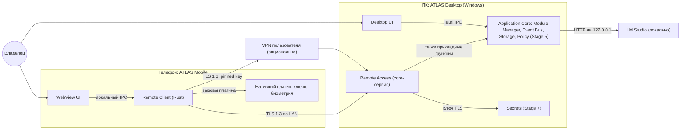
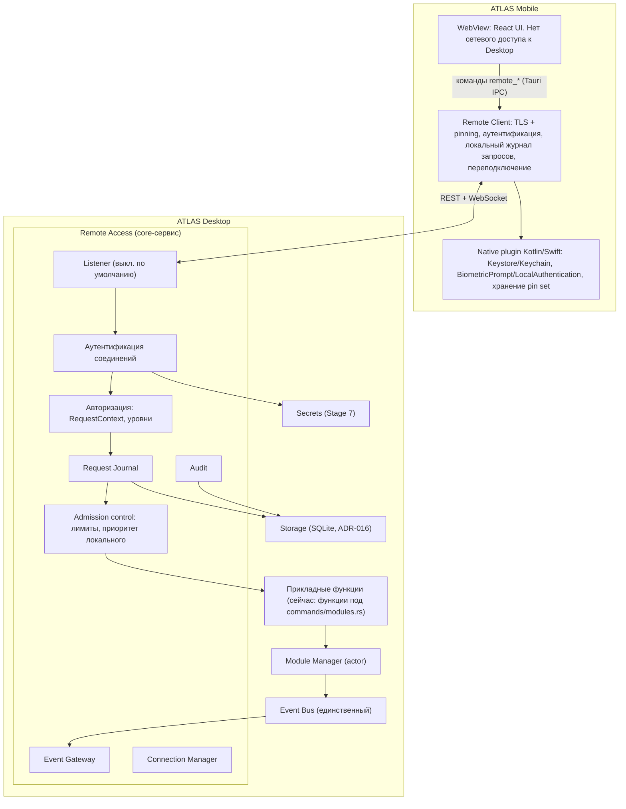

# 01. ATLAS MPA — главный архитектурный документ (REV3)

**Статус: PROPOSED.** Обозначения — `README.md` §3. Подробности — в документах 02–14; здесь только целое и границы.

## 1. Исходные условия

| Условие | Источник |
|---|---|
| Мобильное приложение — и самостоятельный ассистент, и удалённое управление Desktop; Android + iOS; LAN + Internet; подготовка сейчас, реализация позже; Desktop: Windows, Tauri 2, Rust, React/TS, LM Studio, local-first, управление ПК только командами с разрешениями | [ВЛАДЕЛЕЦ] ТЗ первой задачи MPA (таблица направлений продукта) |
| Standalone + Connected; LAN + Internet + Offline; VPN — предпочтительный вариант Internet для MVP; собственный relay отложен; без автоматической синхронизации в MVP; без очереди отложенных команд; Communication Layer внутри Desktop Core; Mobile только через защищённый API; Event Gateway — только разрешённые события; у Mobile нет доступа к БД, Event Bus, shell и внутренним модулям | [ВЛАДЕЛЕЦ] ТЗ 2026-11-20, §4 |
| Secrets остаётся на Stage 7; Connected Mobile MVP не может быть готов раньше нужных возможностей Secrets | [ВЛАДЕЛЕЦ] ТЗ REV3, §4 F-04, §6 CF-6 |
| Remote Access останавливается до модулей; после начала остановки модулей Request Journal не получает записей | [ВЛАДЕЛЕЦ] ТЗ REV3, §6 CF-2 (формальное изменение решения 28 — PENDING OWNER APPROVAL, ADR-018) |
| Desktop-порядок, Module Manager, типизированная шина и семантика завершения не меняются | [ВЛАДЕЛЕЦ] ТЗ REV3, §10 |

## 2. Продуктовая модель

**Connected Mode — основной функциональный сценарий первого мобильного MVP.** Standalone развивается ступенями; приложение без настроенного AI-провайдера не позиционируется как ассистент. Решение о составе MVP — OD-2 (PENDING OWNER APPROVAL).

| Ступень | Содержание | Позиционирование |
|---|---|---|
| Connected MVP (MPA-4) | сопряжение; статус и управление модулями через Module Manager Desktop; чат с инференсом на Desktop (LM Studio); подтверждённые команды Desktop через Policy | «пульт вашего ATLAS Desktop» |
| Офлайн-оболочка (в составе MVP) | работа без Desktop: список сопряжений, состояние связи, последний снимок Desktop только для чтения с пометкой «устарело», локальные настройки, локальные черновики | не ассистент |
| Standalone MVP (ST-1) | собственный экземпляр ATLAS на телефоне: локальное хранилище, локальная история и черновики, адаптер провайдера; ответы AI только при настроенном провайдере (OD-11) | «локальное рабочее пространство»; «ассистент» — только при провайдере |
| Полный Standalone Assistant (ST-2) | ST-1 + проверенный on-device inference, локальная память, голос, мобильные функции | «ассистент»; только после MS-04 и решения владельца |

On-device inference не обещается до проверенного технического решения (MS-04).

### 2.1 Функции с Desktop и без него

| Функция | Без Desktop | Требует Desktop | Зависимость Desktop (этап `docs/ROADMAP.md`) |
|---|---|---|---|
| Настройки, список сопряжений, состояние связи | да | — | — |
| Сопряжение | — | да (экран и подтверждение на Desktop) | Remote Access (новая задача после G3) |
| Статус и управление модулями | — | да | Stage 1 (Module Manager) + Remote Access |
| Последний снимок Desktop | да, «устарело», только чтение | свежие данные | — |
| Чат с LM Studio | — | да | Stage 3 |
| Команды Desktop | — | да | Stage 5 (Policy) |
| История диалогов Desktop | — | да | Stage 6 |
| Память Desktop | — | да | Stage 6 |
| Локальная история (ST-1) | да | — | конверсационный сервис (Stage 6) как общий код |
| Ответы AI на телефоне | только с настроенным провайдером (OD-11) | — | — |
| On-device inference | только ST-2 после MS-04 | — | — |
| Отложенные команды «на потом» | **никогда** | — | [ВЛАДЕЛЕЦ] |

## 3. Контекст системы

## 4. Компоненты

Пояснения:
- Remote Access не управляет модулями сам: все изменения модулей идут через `ModuleManagerHandle` (`plan` → `apply` с `acknowledged`, ADR-012), как из Desktop UI.
- Event Gateway — подписчик существующей шины, второй шины нет (CF-3, документ 03).
- Request Journal и аудит — новые потребители Storage через типизированные операции внутри `storage/` (CF-5, документ 10).
- Ключ TLS хранится в Secrets (документ 09); Secrets появляется на Stage 7.

## 5. Границы (инварианты)

1. Mobile получает только операции Remote API, и это подмножество операций Desktop UI (документ 06 §4).
2. Нет удалённого shell, SQL, подписки на шину, вызова внутренних интерфейсов модулей.
3. Доверенные атрибуты запроса (`source`, `principal`, `device_id`) определяет сервер (документ 06 §2).
4. Критические проверки (pinning, аутентификация, подпись подтверждений) выполняются в Rust/нативном слое телефона, не в WebView (документ 02).
5. Каждый удалённый запрос с побочным эффектом выполняется не более одного раза; при неизвестном результате — `outcome_unknown`, без автоматического повтора (документ 07).
6. Удалённые запросы не вытесняют локальное управление (документ 08 §6).
7. Listener выключен по умолчанию; секреты не попадают в SQLite, логи и диагностику (документ 09).

## 6. Данные

| Данные | Владелец | Доступ в Connected Mode | Синхронизация |
|---|---|---|---|
| История, память, реестр устройств, Request Journal, аудит, состояние модулей Desktop | Desktop | только через Remote API | нет |
| История и настройки телефона (ST-1) | телефон | — | нет |
| Общая конфигурация | нет в MVP | — | нет |
| Офлайн-очередь телефона | телефон, только черновики | — | — |

Автоматической синхронизации в MVP нет [ВЛАДЕЛЕЦ]. Явное копирование с указанием источника и Versioned Sync API — после MVP, отдельным ADR. Входные данные для схем Stage 6: UUID записей, `origin_instance_id`, `version`, поддержка tombstone (задача MD-04).

## 7. Последовательность (итог F-04)

Connected Mobile MVP **не может быть готов раньше**, чем Desktop получит: завершение Stage 1 (#21 этап E), CSP, возможности Secrets (Stage 7 + расширение для хранения ключей, документ 09 §8), Remote Access (новые задачи после G3). С учётом утверждённого порядка это **после Stage 7**. Подробно — документ 11 §3.

## 8. Карта документов

| Тема | Документ |
|---|---|
| Клиент на телефоне, граница WebView/Rust/native | 02 |
| Remote Access, Event Gateway, завершение | 03 |
| Угрозы, доверие, инварианты | 04 |
| Сопряжение, ключи, аутентификация | 05 |
| Права, RequestContext, гонки | 06 |
| Request Journal, подтверждения, повторы | 07 |
| Сеть, переподключение, приоритет локального | 08 |
| Secrets | 09 |
| Совместимость с Desktop | 10 |
| Roadmap и зависимости | 11 |
| ADR-017…020 | 12 |
| Право и распространение | 13 |
| Будущие задачи | 14 |
