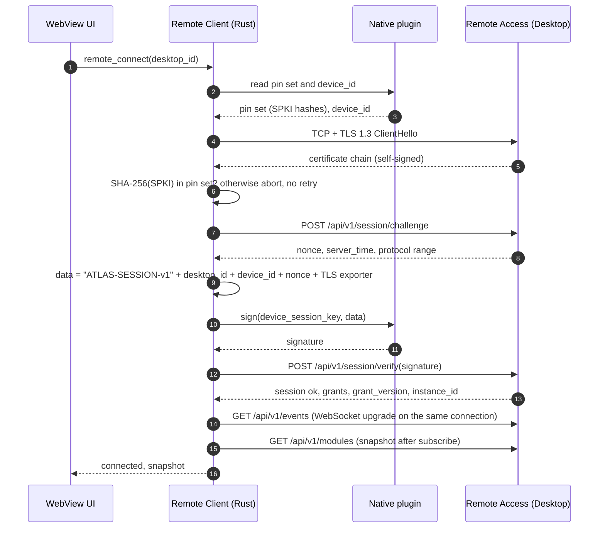

# 02. Архитектура мобильного клиента (REV3)

**Статус: PROPOSED.** Закрывает находку **F-01** (сетевой клиент не может работать в WebView). Проверка решения — спайк MS-03a (документ 14); до него решение имеет статус «описано, не проверено».

## 1. Проблема F-01

`fetch` и `WebSocket` в WebView не дают приложению закрепить самоподписанный ключ Desktop и не позволяют выполнить аутентификацию устройства аппаратным ключом. В браузерный WebSocket нельзя добавить заголовки авторизации [ВНЕШН: стандартные Web API]. REV2 размещал «transport client» в слое представления (REV2 `MOBILE_ARCHITECTURE.md` §4) и предлагал транспортный интерфейс в `src/lib/ipc.ts` (REV2 `PLATFORM_COMPATIBILITY_AUDIT.md` строка 19). REV3 это отменяет.

## 2. Слои и границы

| Слой | Ответственность | Чего не делает |
|---|---|---|
| **WebView (React UI)** | экраны, ввод, отображение состояний запросов; вызывает только локальные команды `remote_*` мобильного приложения | не открывает сетевых соединений к Desktop; не видит ключей, pin set, токенов, подписей; не формирует подтверждение |
| **Remote Client (Rust-ядро мобильного приложения)** | TLS 1.3 и проверка pin; аутентификация соединения; построение канонического Intent и `intent_hash`; локальный журнал запросов телефона; переподключение; разбор ответов; формирование текста подтверждения | не хранит приватные ключи (только ссылки на ключи в плагине) |
| **Нативный плагин (Kotlin / Swift)** | генерация и использование неэкспортируемых ключей (Android Keystore, iOS Keychain/Secure Enclave); биометрический запрос с системным текстом; защищённое хранение pin set и `device_id`; нативный экран подтверждения сопряжения | не принимает решений о повторах; не обращается к сети |

### 2.1 Почему WebView не может обойти проверки

1. **Сеть.** CSP мобильного приложения разрешает WebView только IPC Tauri (`connect-src` без адресов Desktop) [ПРЕДЛ; точные значения CSP для мобильных платформ Tauri — проверить в MS-03a]. Возможности (capabilities) мобильного окна не включают HTTP/WebSocket-плагины Tauri.
2. **Команды.** WebView получает только высокоуровневые команды: `remote_list_desktops`, `remote_connect`, `remote_submit_intent{operation, arguments}`, `remote_request_status`, `remote_cancel`, `remote_start_pairing`. Команды «отправить произвольный HTTP-запрос», «записать pin», «подписать данные» не существуют.
3. **Подтверждение.** Текст биометрического запроса формирует Rust из канонического Intent, а показывает его системный диалог: Android `BiometricPrompt` (заголовок и описание), iOS `LocalAuthentication` (`localizedReason`). WebView не может подменить показанный текст.
4. **Сопряжение.** Данные QR разбирает Rust. Имя Desktop и код подтверждения показывает нативный экран, а не WebView. Иначе скомпрометированный WebView мог бы привязать телефон к Desktop злоумышленника и отправлять туда запросы пользователя.
5. **Pin set** записывает только процедура сопряжения или ротации в Rust. У WebView нет команды для изменения pin set.

## 3. Сетевое взаимодействие

Порядок «подписка → снимок» повторяет существующий протокол готовности UI: подписка, затем `list_modules` [ДОК: ADR-013, #11]. Аутентификация выполняется **на каждом TLS-соединении** и привязана к TLS exporter (RFC 8446 §7.5). Токены между соединениями не переносятся (документ 05 §4).

## 4. Certificate pinning

| Вопрос | Решение [ПРЕДЛ] |
|---|---|
| Что закрепляется | SHA-256 от SubjectPublicKeyInfo (SPKI) ключа TLS Desktop; хранится pin set `{desktop_id, current_spki, next_spki?, addresses[], pinned_at}` |
| Самоподписанный сертификат | доверие определяется **только** совпадением SPKI с pin set. Цепочка CA, имя хоста (адреса меняются) и срок действия сертификата не проверяются: сертификат — лишь контейнер ключа. Подлинность сервера доказывает TLS-рукопожатие с закреплённым ключом |
| Версия TLS | только 1.3; иное — отказ |
| Хранение pin set | Android: в приватном хранилище приложения с защитой целостности ключом Keystore; iOS: Keychain, доступ `ThisDeviceOnly` [ПРЕДЛ; библиотеки выбираются в MS-03a]. Pin set не секретен, но его подмена опасна, поэтому защищается целостность |
| Обновление pin set | только (а) при сопряжении; (б) при плановой ротации: Desktop присылает анонс нового ключа, подписанный текущим, по аутентифицированному соединению (документ 05 §6) |
| Смена сертификата без анонса | соединение разрывается, автоматических повторов нет. Сообщение: «Ключ Desktop изменился. Выполните повторное сопряжение на Desktop». Кнопки «доверять всё равно» нет |
| Несколько Desktop | у каждого свой pin set и `device_id`; в MVP активен один Desktop [ПРЕДЛ] |

## 5. Ошибки, повторы, переподключение (клиент)

| Класс | Пример | Автоматический повтор | Действие пользователя |
|---|---|---|---|
| Сеть недоступна / разрыв | нет маршрута, таймаут TCP | да: переподключение с экспоненциальной задержкой и джиттером (1, 2, 4… до 30 с) [ПРЕДЛ] | нет |
| Pin не совпал | `pin_mismatch` | **нет** | повторное сопряжение |
| Устройство отозвано | `revoked` | **нет**; локальная сессия очищается | повторное сопряжение на Desktop |
| Сессия истекла | `unauthenticated` | да: новый challenge (без побочных эффектов) | нет |
| Версия протокола | `protocol_unsupported` | нет | обновить приложение или Desktop |
| Ограничение частоты | `rate_limited` + `retry_after` | да, после `retry_after` | нет |
| Занято | `busy` (лимит запросов устройства) | нет для новых намерений; статус можно опрашивать | дождаться завершения текущего запроса |
| Remote Access выключен | `remote_disabled` или отказ соединения | только редкие попытки (раз в минуту) [ПРЕДЛ] | включить на Desktop |
| Ошибка сервера 5xx | — | да, с задержкой; для запросов с побочным эффектом — только по правилам документа 07 §7 | нет |

Повтор **запроса с побочным эффектом** выполняется только повторной отправкой того же Intent с тем же `request_id` (безопасно благодаря дедупликации) или запросом статуса. Новый `request_id` и новое биометрическое подтверждение без действия пользователя не создаются (документ 07 §7, общая схема переподключения — документ 07 §8).

## 6. Жизненный цикл приложения

| Событие ОС | Поведение |
|---|---|
| Уход в фон | WebSocket закрывается; незавершённые запросы остаются в локальном журнале со статусом «ожидает ответа» |
| Возврат на передний план | переподключение → запрос статусов всех локально ожидающих `request_id` → новый снимок |
| Завершение процесса ОС | локальный журнал телефона (SQLite телефона) сохраняет `request_id` и Intent до отправки; после запуска — как при возврате |
| Фоновая работа | **нет в MVP**. iOS приостанавливает приложение вскоре после ухода в фон [ВНЕШН: Apple DTS «iOS Background Execution Limits»]; Android 12+ ограничивает запуск foreground service из фона, Android 14+ требует тип сервиса [ВНЕШН: developer.android.com] |
| Выполнение на Desktop после ухода телефона в фон | продолжается; результат телефон получает при возврате |

## 7. Локальное хранение на телефоне

| Данные | Где | Защита |
|---|---|---|
| Приватные ключи устройства | Keystore / Keychain (Secure Enclave на iOS) | неэкспортируемые; `device_confirmation_key` требует биометрию при каждом использовании |
| pin set, `device_id`, `desktop_id` | Keychain / приватное хранилище с контролем целостности | §4 |
| Локальный журнал запросов (`request_id`, Intent, `intent_hash`, последний статус) | SQLite телефона | защита ОС; шифрование БД — OD-13 |
| Снимок Desktop | память / SQLite телефона | помечается «устарело», не служит источником истины |
| Пароли, токены, ответы LM Studio | не хранятся без необходимости; история Desktop не кэшируется в MVP [ПРЕДЛ] | — |

## 8. Различия платформ

| Тема | Android | iOS |
|---|---|---|
| Сборка | SDK, NDK, JDK, Rust-цели Android [ВНЕШН: Tauri prerequisites] | **только macOS + полный Xcode** [ВНЕШН] |
| Аппаратные ключи | Keystore, StrongBox на части устройств [ВНЕШН] | Secure Enclave (только P-256) [ДОПУЩ: проверить в MS-03a] |
| Алгоритм ключей устройства | ECDSA P-256 [ПРЕДЛ] — общий для обеих платформ | то же |
| Локальная сеть | — | разрешение Local Network и `NSLocalNetworkUsageDescription`; для mDNS — `NSBonjourServices` [ВНЕШН] |
| Сканирование QR | официальный плагин barcode-scanner тянет Google Play services ML Kit [ВНЕШН: `build.gradle.kts` плагина] — лицензионный и функциональный риск (R-15) | системные фреймворки камеры [ДОПУЩ] |
| Требования магазина | target API 36 с 31.08.2026; верификация разработчика (документ 13) | privacy manifest, App Privacy, export compliance (документ 13) |

## 9. Standalone-экземпляр (ST-1)

Общее Rust-ядро с мобильным каталогом модулей, задаваемым при компиляции (ADR-011), локальной SQLite и адаптером провайдера. Сборка ядра и хранилища под Android и iOS не проверена: собирается ли вендорный `sqlx-sqlite` с bundled SQLite 3.54.1 — спайки MS-01/MS-02, гейты G1/G2. Источник AI — OD-11. Шифрование данных — OD-13.

## 10. Что проверяет спайк MS-03a (без Desktop)

TLS 1.3 с проверкой SPKI в Rust на обеих платформах; подпись challenge ключом Keystore/Secure Enclave через плагин; биометрический запрос с текстом из Rust; хранение pin set; невозможность сетевого доступа WebView при выбранной CSP; переподключение при уходе в фон. Критерии — документ 14, MS-03a.
