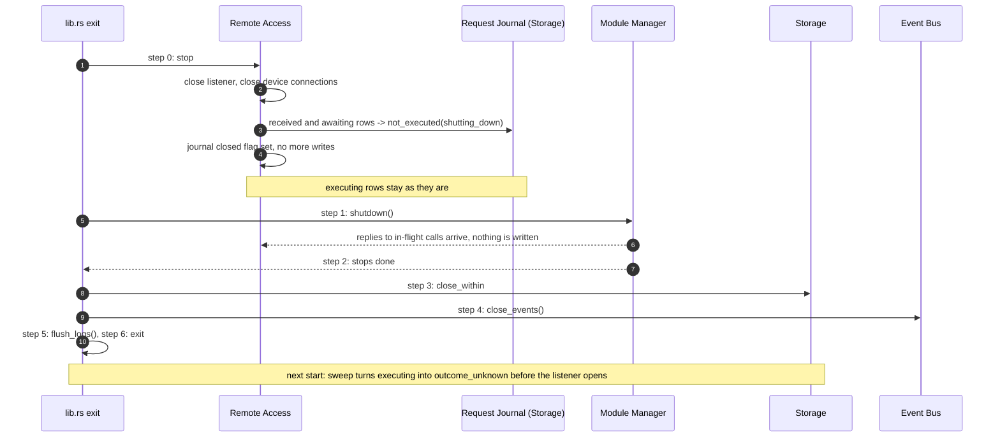

# 03. Архитектура Remote Access (Desktop, REV3)

**Статус: PROPOSED.** Связанные ADR: ADR-018 (PROPOSED). Конфликты CF-1…CF-4 — §2, §7, §8; CF-5 — документ 10; CF-6 — документ 09.

## 1. Назначение

Remote Access — core-сервис Desktop. Он принимает запросы сопряжённых устройств, проверяет их и вызывает **те же прикладные функции**, что и команды Tauri IPC. Собственной логики управления модулями у него нет.

## 2. Размещение — CF-1, CF-4

| Вопрос | Решение REV3 | Основание |
|---|---|---|
| Core Service или модуль | **Core Service**: создаётся при старте, Module Manager им не управляет | CF-4: модулю нужен `ModuleManagerHandle`, а решение 3 и ADR-014 это запрещают («Доступа к менеджеру и публикации событий у модуля нет», `DECISIONS.md:79`). Указание владельца — ТЗ REV3 §6 CF-4 |
| «Core-сервисы не отключаются» (ADR-011, `DECISIONS.md:17`) | сервис существует всегда; **сетевой listener выключен по умолчанию** и включается подтверждённой локальной настройкой Desktop | CF-1: у существующих core-сервисов уже бывают нерабочие состояния (Storage `ReadOnly`/`Unavailable`, ADR-016; запасной вывод логов). Указание владельца — ТЗ REV3 §6 CF-1 |
| Отдельный процесс | нет | [ВЛАДЕЛЕЦ] Communication Layer внутри Desktop Core (ТЗ 2026-11-20 §4) |

Формальное закрепление — ADR-018. ADR-011 и ADR-014 не меняются.

### 2.1 Состояния сервиса

| Состояние | Listener | Когда | Видно в UI Desktop |
|---|---|---|---|
| `disabled` | закрыт | по умолчанию; после выключения пользователем | «Удалённый доступ выключен» |
| `unavailable` | закрыт | нет ключа TLS, Secrets недоступен, Storage не `Ready` | причина и действие («повторное сопряжение», «проверьте хранилище») |
| `listening` | открыт на выбранном адресе | включён и все проверки старта пройдены | адрес, число устройств |
| `stopping` | закрыт | шаг 0 завершения (§7) | — |

Автоматического перезапуска нет: из `unavailable` сервис выходит только по действию пользователя (по образцу решения 12, ADR-014).

## 3. Внутреннее устройство

| Компонент | Ответственность | Хранение |
|---|---|---|
| Listener | TLS 1.3 на выбранном интерфейсе (документ 08 §3) | — |
| Аутентификация | challenge соединения, проверка ключа устройства и отзыва | реестр устройств (SQLite) |
| Авторизация | `RequestContext`, уровни, проверка `grant_version` | — |
| Request Journal | состояния удалённых запросов, дедупликация, подтверждения | SQLite (новая таблица) |
| Admission control | лимиты, очередь, приоритет локального управления | память |
| Event Gateway | доставка разрешённых событий шины устройствам | память (буфер на соединение) |
| Connection Manager | учёт соединений по `device_id`, закрытие при отзыве или выключении | память |
| Audit | неизменяемые записи о действиях | SQLite (новая таблица) |

## 4. Remote API v1 (контракт)

Все маршруты работают только после аутентификации соединения (документ 05 §4), кроме `session/*`.

| Метод и путь | Операция | Мин. уровень (модель C, OD-5) | Журнал | Ответ |
|---|---|---|---|---|
| `POST /api/v1/session/challenge` | начать аутентификацию | сопряжённое устройство | нет (аудит неудач) | `{nonce, server_time, protocol:{min,max}}` |
| `POST /api/v1/session/verify` | завершить аутентификацию | — | нет (аудит) | `{grants, grant_version, instance_id}` |
| `GET /api/v1/events` (WebSocket) | подписка на события | Read | нет | поток `RemoteEvent` |
| `GET /api/v1/modules`, `GET /api/v1/modules/{id}` | снимок | Read | нет | `ModuleDto` v1 |
| `POST /api/v1/modules/{id}/plan` | план изменения | Read | нет | `ChangePlanDto` v1 |
| `GET /api/v1/modules/{id}/settings` | настройки | Admin (рекоменд.) | нет (аудит чтения значений) | `ModuleSettingsDto` v1 |
| `POST /api/v1/requests` | подать Intent с побочным эффектом | по операции | **да** | `RequestStatusDto` |
| `POST /api/v1/requests/{request_id}/confirm` | передать подпись подтверждения | по операции | да | `RequestStatusDto` |
| `GET /api/v1/requests/{request_id}` | статус и результат | Read | нет | `RequestStatusDto` |
| `GET /api/v1/requests?state=nonfinal\|recent` | свои запросы | Read | нет | список |
| `DELETE /api/v1/requests/{request_id}` | отменить ещё не выполняемый запрос | как у операции | да | `RequestStatusDto` |

Операции Intent (`operation`): `module.apply`, `module.check_health`, `module.update_settings`, `module.replace_config` — существуют сейчас (те же функции, что `commands/modules.rs`). Позже: `chat.send`, `chat.cancel` (Stage 3), `tool.execute` (Stage 5), `history.read`, `memory.read`, `memory.edit` (Stage 6). Полная матрица — документ 06 §4. DTO v1 — замороженная копия DTO IPC (`dto/modules.rs`); способ согласования Rust и TS — OD-10.

### 4.1 Ошибки Remote API

| Код | HTTP | Смысл |
|---|---|---|
| `unauthenticated` | 401 | соединение не аутентифицировано или сессия истекла |
| `revoked` | 401 | устройство отозвано |
| `forbidden` | 403 | недостаточно прав |
| `protocol_unsupported` | 426 | несовместимая версия |
| `rate_limited` | 429 | превышен лимит, есть `retry_after` |
| `busy` | 429 | у устройства уже есть незавершённый запрос с побочным эффектом |
| `request_id_conflict` | 409 | тот же `request_id` с другим `intent_hash` |
| `confirmation_invalid` / `confirmation_expired` | 400 / 409 | подпись не прошла проверку или challenge истёк |
| `not_found` | 404 | нет такого запроса для этого устройства |
| `storage_unavailable` | 503 | Storage не `Ready`; запросы с побочным эффектом не принимаются |
| `shutting_down` | 503 | Desktop завершается |
| коды `ErrorDto` (`unknown_module`, `invalid_settings`, …) | 422 | доменные отказы; отражаются в `RequestStatusDto.reason` |

## 5. Event Gateway — CF-3

- Подписчик **единственной** шины (ADR-013), как мост в webview (`events/ui_bridge.rs`, #11). Отдельной шины нет. Gateway ничего не публикует. Входящие сетевые сообщения не попадают в шину, а идут в прикладные функции.
- **Allowlist.** Пересылается только событие, для которого есть отображение в `RemoteEvent` v1 и которое разрешено уровнем устройства. Сейчас это `Module(StatusChanged | HealthChanged | SettingsChanged | ManagerReady)` на уровне Read и `request.updated` — только устройству-владельцу запроса. Демо-события не пересылаются никогда.
- **Буфер на соединение** ограничен. При переполнении буфер сбрасывается и отправляется `resync {missed}`, как при `Lagged` (ADR-013). Буфер содержит только события шины в порядке `seq` и не создаёт уведомлений в обход шины.
- **Почему это не нарушает решение 24.** Решение 24 запрещает отдельные каналы *межмодульных* уведомлений («единственный механизм межмодульных уведомлений», `DECISIONS.md:49`). Gateway — адаптер доставки внешнему потребителю, роль та же, что у `ui_bridge`. Указание владельца — ТЗ REV3 §6 CF-3. Формальная оговорка — ADR-018, без изменения ADR-013.
- В каждом событии передаётся `instance_id` (случайный при каждом запуске Desktop) рядом с `seq`: `seq` начинается с 1 в каждом процессе (ADR-013).

## 6. Запуск

1. Storage открывается (ADR-016); Module Manager создаётся.
2. Remote Access создаётся в состоянии `disabled`.
3. Если пользователь ранее включил удалённый доступ:
   1. загрузить ключ TLS из Secrets (документ 09);
   2. дождаться готовности Storage;
   3. **выполнить сверку Request Journal** (документ 07 §6) — до открытия listener;
   4. открыть listener → `listening`.

   Ошибка любого шага переводит сервис в `unavailable` с причиной.

## 7. Завершение — CF-2

Утверждённый порядок (решение 28; `ARCHITECTURE.md:145–155`): 1) остановить модули; 2) дождаться остановок; 3) закрыть БД — «после модулей писать некому»; 4) `close_events()`; 5) `flush_logs()`; 6) выход. REV3 добавляет **шаг 0** перед шагом 1. Шаги 1–6 не меняются. Изменение решения 28 — PENDING OWNER APPROVAL (ADR-018); направление задано владельцем (ТЗ REV3 §6 CF-2).

**Шаг 0 (Remote Access):**
- (а) закрыть listener;
- (б) закрыть все соединения устройств;
- (в) перевести записи журнала в `received` и `awaiting_confirmation` в `not_executed(shutting_down)`; это последние записи журнала в сеансе;
- (г) установить флаг «журнал закрыт»: после него Remote Access ничего не пишет в Storage;
- (д) запросы в `executing` остаются в БД как есть; их итог фиксирует сверка при следующем запуске (`outcome_unknown`).

Шаг 0 ограничен по времени: 1 с [ПРЕДЛ] — пишется одна транзакция. Его время не входит в `SHUTDOWN_TIMEOUT`, который относится к шагам 1–2.

| Путь выхода | Поведение |
|---|---|
| Закрытие окна (`RunEvent::ExitRequested`) | шаги 0–6 |
| Запасной путь `RunEvent::Exit` | те же шаги; шаг 0 идемпотентен |
| Аварийное завершение, убийство процесса, выключение ОС без шагов | шаг 0 не выполняется; сверка при старте переводит `received`/`awaiting_confirmation` в `not_executed(interrupted)` и `executing` в `outcome_unknown` |
| Известные пробелы выхода Desktop (перезапуск из главного потока, `WM_ENDSESSION`; `ROADMAP_AFTER_MM4` TD-5) | шаг 0 может не выполниться; безопасность обеспечивает сверка (риск R-37) |

## 8. Наблюдаемость

Логи Remote Access содержат: операцию, `device_id`, `request_id`, состояние и код ошибки. Без значений настроек, текстов сообщений, подписей и ключей (по правилу `commands/modules.rs` и ADR-015). Метрики для MPA-2: длина очереди, время ожидания диспетчеризации, доля `outcome_unknown`, отказы по лимитам.
