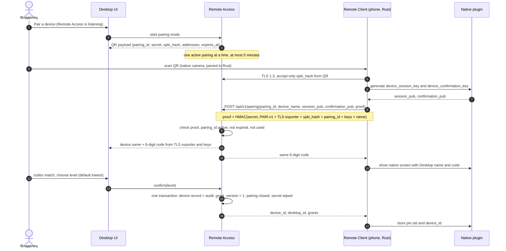
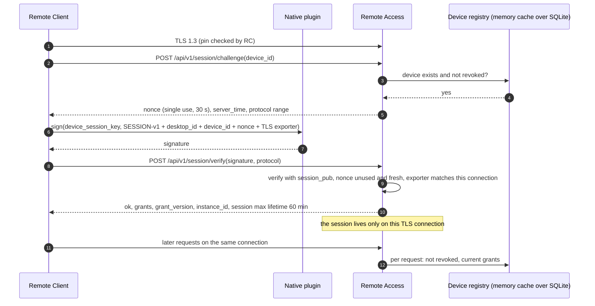

# 05. Сопряжение и аутентификация устройств (REV3)

**Статус: PROPOSED.** Закрывает спецификационные пробелы ревью: привязку сопряжения к TLS (F-13), ротацию, восстановление, закрытие сессий при отзыве. Алгоритмы и библиотеки окончательно выбираются в MPA-2/MS-03a с ревью зависимостей.

## 1. Идентичность

| Сущность | Что это | Где хранится |
|---|---|---|
| `desktop_id` | UUID, создаётся вместе с первым ключом TLS | реестр Desktop (SQLite, открыто), pin set телефона |
| Desktop key `dk<n>` | ключ TLS-сервера (ECDSA P-256 [ПРЕДЛ]) с версией `n` | приватная часть — Secrets (документ 09); SPKI-хэш — открыто |
| `device_id` | UUID, выдаёт Desktop при сопряжении | реестр Desktop, телефон |
| `device_session_key` | ключ устройства для аутентификации соединений; без биометрии | Keystore / Keychain, неэкспортируемый |
| `device_confirmation_key` | ключ для подписей подтверждений; использование — только после биометрии (Android: strong biometric; iOS: текущий набор биометрии) [ПРЕДЛ; проверить в MS-03a] | Keystore / Secure Enclave, неэкспортируемый |
| Запись устройства | `{device_id, name, session_pub, confirmation_pub, grants, grant_version, created_at, last_seen, revoked_at}` | SQLite Desktop: открытые ключи — не секреты |

Сопряжение, отзыв, изменение прав и ротация ключа выполняются **только локально на Desktop** (документ 06 §4.5).

## 2. Сопряжение

Содержимое QR (CBOR или JSON, версия `v=1`): `desktop_id`, `desktop_name`, `addresses[]`, `port`, `spki_hash` (текущий ключ), `pairing_id`, `pairing_secret` (≥128 бит), `expires_at`. `expires_at` показывается пользователю. Срок проверяет только Desktop: часы телефона не используются (риск R-13).

| Правило | Зачем |
|---|---|
| Секрет одноразовый, живёт только в памяти Desktop, не пишется в БД и логи | утечка БД или логов не даёт права на сопряжение |
| `proof` содержит TLS exporter (RFC 8446 §7.5) | сопряжение нельзя перенести на другое TLS-соединение (F-13) |
| 6-значный код на обоих экранах | против N6: увидевший QR может успеть начать сопряжение первым, но пользователь увидит чужое имя и несовпадающий код |
| Подтверждение только на Desktop | украденный телефон не может сопрячь второй |
| Неверный `proof` или код — попытка засчитывается; после 5 неудач режим сопряжения закрывается [ПРЕДЛ] | перебор |
| Аттестация ключа (Android Key Attestation, iOS App Attest) | вне MVP; вариант для ужесточения (риск R-25) |

## 3. Хранение результата на телефоне

pin set и `device_id` записываются плагином (документ 02 §4, §7). Повторное сопряжение с тем же Desktop создаёт **новое** устройство. Старая запись остаётся до отзыва; Desktop показывает устройства с давним `last_seen` и предлагает отозвать их.

## 4. Аутентификация соединения

Каждое TLS-соединение аутентифицируется отдельно. Переносимых bearer-токенов нет.

| Правило | Значение [ПРЕДЛ] |
|---|---|
| Срок nonce | 30 с по часам Desktop |
| Максимальная жизнь сессии | 60 мин; затем новый challenge на том же соединении |
| Неудачи | ограничение частоты по адресу и по `device_id` (документ 08 §6) |
| Реестр | Remote Access — единственный писатель; кэш в памяти обновляется только после успешного commit. Поэтому проверка на каждом запросе не требует чтения SQLite |
| WebSocket | upgrade на том же аутентифицированном соединении |

## 5. Отзыв устройства и закрытие сессий

1. Пользователь на Desktop отзывает устройство.
2. Одна транзакция: `revoked_at`, `grant_version += 1`, аудит; после commit обновляется кэш.
3. Connection Manager закрывает все HTTP- и WebSocket-соединения этого `device_id` с причиной `revoked`.
4. Запросы устройства в журнале:
   - `received` и `awaiting_confirmation` → `not_executed(revoked)` в той же транзакции, что отзыв;
   - `executing` не прерываются (прервать уже начатую операцию небезопасно, ADR-014); итог записывается, но устройству не доставляется.
5. Любой следующий запрос устройства получает `revoked`. Event Gateway перед отправкой проверяет кэш реестра.

## 6. Ротация ключей

| Вид | Процедура [ПРЕДЛ] | Влияние на сопряжения |
|---|---|---|
| Плановая ротация ключа Desktop | Secrets создаёт `dk<n+1>`. Remote Access рассылает по аутентифицированным соединениям анонс `{desktop_id, n+1, spki_hash_next}`, подписанный `dk<n>`; телефоны добавляют `next_spki`. Через окно перекрытия (7 дней [ПРЕДЛ]) listener переходит на `dk<n+1>`; телефоны делают `next` текущим; `dk<n>` удаляется | телефоны, не подключавшиеся в окне, сопрягаются заново |
| Экстренная ротация (подозрение на компрометацию) | пользователь запускает её на Desktop; новый ключ; **все сопряжения отзываются** | повторное сопряжение всех устройств |
| Ротация ключей устройства | телефон создаёт новую пару, подписывает анонс старым `device_session_key` по аутентифицированному соединению; Desktop заменяет ключ, `grant_version += 1`; старый ключ далее отклоняется | без повторного сопряжения |
| Срок действия сертификата | не используется для доверия (pin); сертификат перевыпускается вместе с ключом | — |

## 7. Восстановление

| Событие | Действия |
|---|---|
| Телефон потерян или украден | отзыв на Desktop (список устройств с `last_seen`); соединения закрываются сразу |
| Ключи телефона потеряны (переустановка, сброс) | повторное сопряжение как нового устройства; старое отозвать |
| Ключ Desktop потерян или не читается (документ 09 §7) | Remote Access → `unavailable`; новый ключ только по действию пользователя; затем все устройства сопрягаются заново |
| Подозрение на компрометацию Desktop | вне модели удалённого доступа: отключить Remote Access, экстренная ротация, отзыв всех устройств |
| Desktop переустановлен на другой профиль или ПК | ключ DPAPI привязан к профилю [ДОПУЩ: проверить на этапе Secrets] → как потеря ключа |
