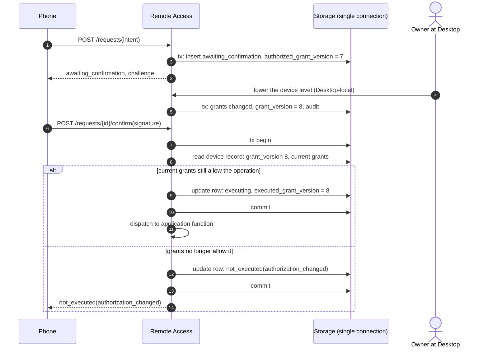

# 06. Авторизация и права (REV3)

**Статус: PROPOSED.** Модель уровней — **OD-5, PENDING OWNER APPROVAL**. Модель `RequestContext` — **OD-14, PENDING OWNER APPROVAL**. Закрывает уточнение **B** ТЗ REV3 (гонка прав) и находки ревью F-08, F-16, F-17.

## 1. Принципы

1. Доверенные атрибуты запроса определяет сервер.
2. Удалённые операции — подмножество операций Desktop UI.
3. Remote Access добавляет проверки. Он не заменяет и не пропускает проверки Module Manager (ADR-012) и Policy (Stage 5).
4. По умолчанию — отказ; после сопряжения — минимальный уровень.

## 2. RequestContext

```text
RequestContext {
  source:     DesktopUi | Mobile | Telegram | InternalSystem
  principal:  Owner | TelegramUser(id)       // см. §3
  device_id:  Option<DeviceId>               // только Mobile
  session_id: Option<SessionId>              // только Mobile
  request_id: RequestId                      // Mobile: от клиента, в пределах device_id
  grant_version: Option<u64>                 // версия прав устройства на момент проверки
}
```

| Атрибут | Кто задаёт | Основание доверия | Может ли клиент передать |
|---|---|---|---|
| `source` | точка входа: обработчики Tauri IPC → `DesktopUi`; listener Remote Access → `Mobile`; модуль Telegram → `Telegram`; задачи ядра → `InternalSystem` | IPC доступен только коду приложения [ВНЕШН: Tauri capabilities] **при условии CSP** (сейчас `csp: null`, `tauri.conf.json:21`, F-17); listener — отдельный сокет с аутентификацией | **нет**; поле `source`/`origin` в запросе игнорируется и пишется в лог |
| `principal` | сервер | `DesktopUi` — локальный владелец; `Mobile` — владелец через запись устройства; `Telegram` — §3 | **нет** |
| `device_id`, `session_id` | сервер, из аутентифицированного соединения | документ 05 §4 | **нет** |
| `request_id` | клиент | уникальность в пределах `device_id`; дедупликация — документ 07 | да |
| `grant_version` | сервер, из реестра | документ 05 §1 | **нет** |

`RequestContext` — входные данные для проектирования Policy (Stage 5). Кода сейчас не требуется.

## 3. Telegram: только владелец или несколько пользователей

Stage 7 предусматривает allowlist Telegram (`docs/ROADMAP.md:10`). В allowlist могут оказаться не только сам владелец. REV2 приравнивал любой чат из allowlist к владельцу — это было допущением (риск R-16).

| Вариант | Суть | Плюсы | Минусы |
|---|---|---|---|
| T1. Только владелец | allowlist содержит только Telegram-идентификаторы владельца; `principal = Owner` | просто; совпадает с моделью однопользовательского ассистента (`CLAUDE.md`) | нельзя дать доступ семье или коллегам без изменения модели |
| T2. Несколько пользователей сразу | `principal = TelegramUser(id)` с собственными правами (например, только чат, без команд) | гибко | нужна модель прав на пользователя, разделение истории и памяти; ощутимое расширение Stage 7 |
| T3. Сейчас только владелец, модель расширяема [ПРЕДЛ] | как T1, но `principal` — перечисление, а не флаг. Записи журнала и аудита хранят `principal`. Многопользовательский режим — отдельное будущее решение | без миграций в будущем | немного больше полей сейчас |

Рекомендация команды — T3. Owner-only **не считается** утверждённым. Решение входит в OD-14 (PENDING OWNER APPROVAL) и должно быть принято до проектирования Policy (Stage 5) и Telegram (Stage 7).

## 4. Уровни и матрица операций

### 4.1 Модели уровней (OD-5, PENDING OWNER APPROVAL)

| Модель | Определение | Последствия |
|---|---|---|
| A. Накопительная | Read ⊂ Control ⊂ Execute ⊂ Admin | проще всего; выдача Admin (управление модулями) автоматически даёт выполнение команд ПК |
| B. Независимые права | любой набор; Read подразумевается любым другим | гибко; больше комбинаций в UI и тестах |
| C. Гибрид [рекомендация команды] | Read ⊂ Control ⊂ Admin — цепочка; **Execute — отдельное право**, требует хотя бы Control | управление ПК (наибольший риск, ADR-008) отделено от администрирования модулей; одно дополнительное право в UI |

Ниже «Мин. уровень» указан для модели C. Для модели A Execute входит в Admin. Для модели B каждая строка требует своего права.

### 4.2 Сессия и чтение

| Операция | Мин. уровень | Подтверждение | Кто | Из фона телефона | Побочный эффект | Журнал | Аудит | Где проверка |
|---|---|---|---|---|---|---|---|---|
| challenge / verify | сопряжённое | нет | — | нет | создаёт сессию | нет | неудачи | аутентификация (05 §4) |
| события (WebSocket) | Read | нет | — | нет (закрывается) | нет | нет | начало/конец | авторизация + allowlist (03 §5) |
| `module.list`, `module.get` | Read | нет | — | нет | нет | нет | нет | авторизация; данные из `watch`-снимка, без актора [КОД: `manager.rs:269–305`] |
| `module.plan` | Read | нет | — | нет | нет | нет | нет | авторизация; план из снимка [КОД: `manager.rs:311–319`] |
| `module.get_settings` | Admin [ПРЕДЛ; альтернатива Read — подвопрос OD-5] | нет | — | нет | нет, но возвращает пользовательские данные | нет | да (факт чтения) | авторизация |
| статус запросов | Read | нет | — | нет | нет | нет | нет | авторизация; только свои запросы |

### 4.3 Операции с модулями (существуют; те же функции, что у Desktop UI)

| Операция | Мин. уровень | Подтверждение | Кто | Из фона | Побочный эффект | Журнал | Аудит | Где проверка |
|---|---|---|---|---|---|---|---|---|
| `module.check_health` | Control | нет | — | нет | ограниченный: код модуля выполняется; поздняя паника → `Failed{HealthCheck}` с каскадом (ADR-014) | да | да | авторизация → журнал → Module Manager |
| `module.apply` enable/disable/restart | Admin | при `affected` в плане — `acknowledged` (ADR-012) + биометрия [ПРЕДЛ] | владелец на телефоне видит план с зависимыми | нет | да | да | да | авторизация → журнал (повторная проверка при `executing`) → Module Manager `verify` |
| `module.apply` recover | Admin | **всегда** (ADR-012) + биометрия | владелец на телефоне | нет | да | да | да | то же |
| `module.update_settings` | Admin | биометрия [ПРЕДЛ] | владелец на телефоне | нет | да (`restart_required`, без перезапуска) | да | да (без значений) | авторизация → журнал → Module Manager (валидация ADR-015) |
| `module.replace_config` | Admin | **всегда** (`confirmed=true`, #21) + биометрия; альтернатива — только на Desktop (подвопрос OD-5) | владелец на телефоне или на Desktop | нет | да (замена повреждённой записи; модуль остаётся выключен) | да | да | авторизация → журнал → Module Manager |

### 4.4 Будущие операции (аддитивно)

| Операция | Мин. уровень | Подтверждение | Кто | Из фона | Побочный эффект | Журнал | Аудит | Нужен этап |
|---|---|---|---|---|---|---|---|---|
| `chat.send` (инференс на Desktop) | Control | нет | — | нет | да (нагрузка LM Studio; запись истории, если есть Stage 6) | да (без текста) | да | Stage 3 |
| `chat.cancel` | Control | нет | — | нет | да | да | да | Stage 3 |
| `history.read` | Control (содержимое, не статус) | нет | — | нет | нет | нет | да | Stage 6 |
| `memory.read` | Control | нет | — | нет | нет | нет | да | Stage 6 |
| `memory.edit` / удаление | Admin | биометрия; удаление — вариант «только на Desktop» | владелец | нет | да | да | да | Stage 6 |
| `tool.execute` только чтение | Execute | по Policy | по Policy | нет | нет изменений ОС | да | да | Stage 5 |
| `tool.execute` изменяющая | Execute | биометрия | владелец на телефоне | нет | да | да | да | Stage 5 |
| `tool.execute` необратимая | Execute | да | **на Desktop** [ПРЕДЛ] | нет | да | да | да | Stage 5 |
| произвольный shell / скрипт | **не предоставляется ни на каком уровне** | — | — | — | — | — | отказ в аудит | — |

«Из фона»: в MVP телефон не инициирует запросы в фоне (документ 02 §6). Запрос, начатый на переднем плане, на Desktop выполняется до конца, даже если телефон ушёл в фон.

### 4.5 Только локально на Desktop (никогда удалённо)

Сопряжение, отзыв, изменение прав устройства, включение и выключение Remote Access, ротация ключей, просмотр и экспорт аудита, изменение правил Policy. Причина: украденный телефон не должен расширять или сохранять собственный доступ.

## 5. Где выполняются проверки (уровни L1–L6)

| Уровень | Что проверяется | Компонент |
|---|---|---|
| L1 транспорт | TLS 1.3, listener включён; на телефоне — pin | Listener / Remote Client |
| L2 аутентификация | сессия этого соединения, устройство не отозвано | Remote Access (05 §4) |
| L3 авторизация | права ≥ минимума операции; операция доступна удалённо | Remote Access |
| L4 журнал | дедупликация, подтверждение, **повторная проверка L2–L3 при `executing`** | Request Journal (07) |
| L5 домен | `plan`/`verify`, `acknowledged`, валидация настроек, правила `replace_config` | Module Manager (без изменений) |
| L6 Policy | allowlist команд, типизированные аргументы, политика по `source` | Policy (Stage 5) |

## 6. Гонка «изменение прав ↔ received → executing» (уточнение B)

| Вопрос | Решение [ПРЕДЛ] |
|---|---|
| Когда проверяются права | (1) при приёме — L2–L3, фиксируется `authorized_grant_version`; (2) **непосредственно при переходе в `executing`** — в той же транзакции Storage, что и запись `executing` |
| Как фиксируется версия | запись устройства хранит `grant_version`, который увеличивается при любом изменении прав, уровня или отзыве. Для команд Stage 5 запись журнала дополнительно хранит `policy_version` |
| Права изменились во время ожидания подтверждения | при переходе права вычисляются заново по **текущей** записи устройства и текущей Policy. Недостаточно → `not_executed(authorization_changed)`. Достаточно → выполнение; в журнал пишутся обе версии |
| Нужна ли повторная проверка перед выполнением | да, всегда. Переход в `executing` — точка линеаризации авторизации |
| Устаревшие разрешения | невозможны: проверка и запись `executing` атомарны. Реестр меняет только Remote Access через ту же единственную очередь Storage (ADR-016: одно соединение). Отзыв после commit `executing` операцию не прерывает (05 §5) |
| Отзыв во время ожидания | отзыв переводит `received`/`awaiting_confirmation` в `not_executed(revoked)` в своей транзакции (05 §5) |


