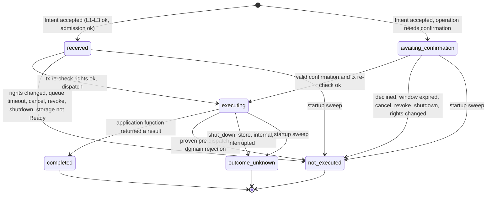
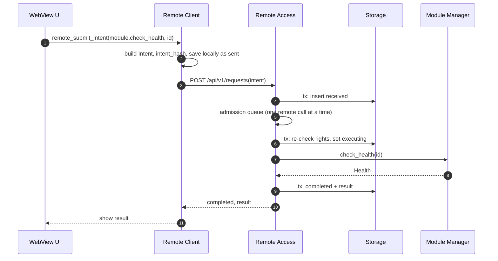
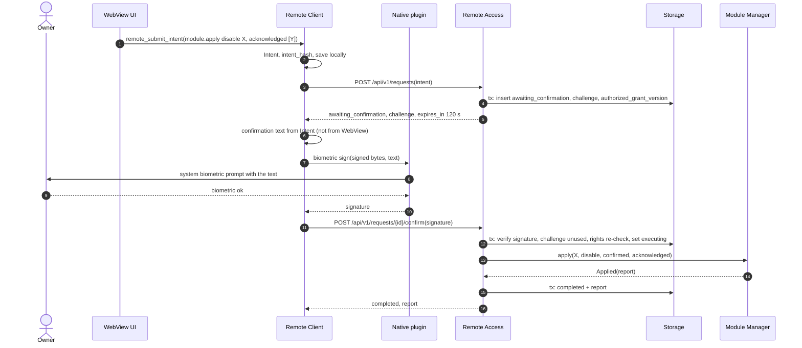
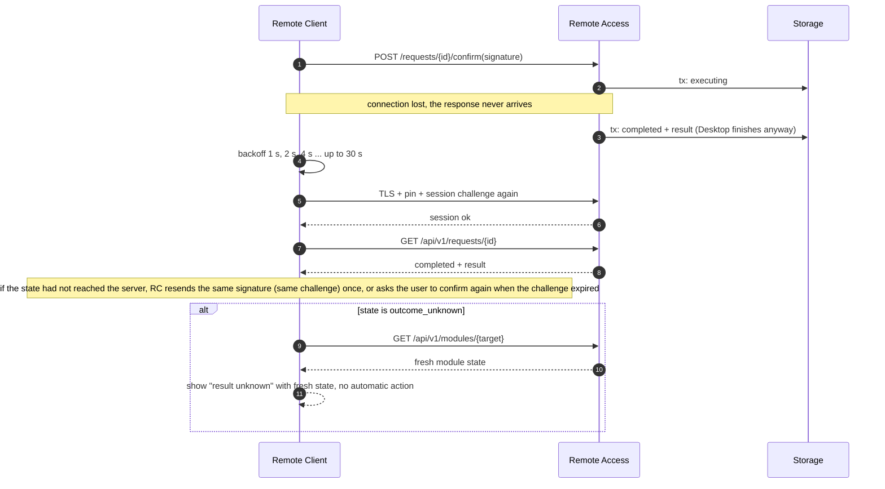

# 07. Жизненный цикл удалённого запроса и Request Journal (REV3)

**Статус: PROPOSED.** Закрывает **F-02** (циклическая зависимость подтверждения и хэша), **F-03** (`shut_down` и неопределённость результата) и уточнения **B** и **D** ТЗ REV3. Схема хранения — проект без миграции; миграция появится в задаче MD-06/MI-06 и потребует ревью владельца (`CLAUDE.md`, ADR-016).

## 1. Цель и область

Удалённый запрос с побочным эффектом выполняется **не более одного раза**: даже при потере ответа, переподключении телефона или аварии Desktop. Если подтвердить результат нельзя, запрос получает состояние `outcome_unknown`, и решение принимает пользователь. Автоматического повторного выполнения нет (по образцу решения 12, ADR-014, ADR-015).

| Класс | Операции | Журнал |
|---|---|---|
| Чтение | `module.list`, `module.get`, `module.plan`, `module.get_settings`, статус запросов | нет; повтор безопасен |
| С побочным эффектом | `module.apply`, `module.check_health`, `module.update_settings`, `module.replace_config`; позже `chat.send`, `chat.cancel`, `tool.execute`, `memory.edit` | **да** |

## 2. Идентичность запроса и канонический Intent

### 2.1 `request_id`

UUIDv4. Телефон создаёт его один раз на одно намерение пользователя и записывает в локальный журнал **до** отправки. Он повторяется при каждой повторной отправке того же намерения и никогда не используется для другого. Время внутри идентификатора не используется: часы телефона не сравниваются с часами Desktop (риск R-13; заменяет UUIDv7 из REV2).

### 2.2 Канонический Intent

```text
Intent v1 = {
  "v": 1,
  "desktop_id":  "<uuid>",
  "device_id":   "<uuid>",
  "request_id":  "<uuid v4>",
  "operation":   "module.apply" | "module.check_health" | "module.update_settings" | "module.replace_config" | ...,
  "target":      { "module_id": "<id>" },
  "arguments":   { ... по операции, см. 2.3 ... }
}
intent_bytes = JCS(Intent)        // RFC 8785, канонический JSON
intent_hash  = SHA-256(intent_bytes)
```

| Входит в `intent_hash` | Не входит в `intent_hash` |
|---|---|
| версия формата, `desktop_id`, `device_id`, `request_id`, `operation`, `target`, `arguments` | `session_id`, nonce, challenge, подпись подтверждения, решение на Desktop, временные метки, версия клиента, заголовки транспорта |

### 2.3 Аргументы операций (по существующим командам IPC, `commands/modules.rs:155–195`)

| Операция | `arguments` |
|---|---|
| `module.apply` | `{ "action": "enable"\|"disable"\|"restart"\|"recover", "confirmed": bool, "acknowledged": [id…] }` — `acknowledged` отсортирован |
| `module.check_health` | `{}` |
| `module.update_settings` | `{ "settings": <JSON> }` |
| `module.replace_config` | `{ "settings": <JSON>, "confirmed": bool }` |

Значения настроек входят в хэш, но в журнале хранится только `intent_hash`, а не Intent (ADR-015: значения настроек не попадают в журналы).

## 3. Подтверждение (confirmation evidence) — без циклической зависимости

Подтверждение — **отдельный объект**, связанный с запросом, но не входящий в `intent_hash`:

```text
challenge  = 32 случайных байта; выдаёт Desktop; одноразовый; срок 120 с по часам Desktop [ПРЕДЛ]
signed     = "ATLAS-CONFIRM-v1" || desktop_id || device_id || request_id || intent_hash || challenge
signature  = Sign(device_confirmation_key, signed)   // ключ открывается только биометрией
```

Порядок: (1) телефон строит Intent и `intent_hash`; (2) отправляет Intent; (3) Desktop принимает, проверяет права и выдаёт `challenge`; (4) Rust строит текст подтверждения из Intent, системный биометрический диалог показывает его, ключ подписывает `signed`; (5) телефон отправляет подпись; (6) Desktop проверяет подпись открытым `confirmation_pub`, свежесть и неиспользованность challenge и совпадение `intent_hash`. Затем в одной транзакции он повторно проверяет права и переводит запрос в `executing`.

Подпись зависит от `intent_hash`, а `intent_hash` от подписи не зависит — цикла нет.

| Свойство | Как обеспечено |
|---|---|
| Повторная отправка Intent не обходит подтверждение | повтор Intent только возвращает текущее состояние; выполнение требует подписи на **действующем** challenge |
| Повтор перехваченной подписи | challenge одноразовый и привязан к `request_id` и `intent_hash`; после использования подпись бесполезна |
| Повтор подписи после переподключения | тот же challenge, ещё не использованный и не истёкший → принимается один раз; использованный → возвращается состояние запроса без выполнения |
| Истёк challenge | `confirmation_expired`; телефон может запросить новый challenge для того же `request_id` (пока не истекло окно ожидания запроса, 5 мин [ПРЕДЛ]). Новый challenge **требует новой биометрии**; старый аннулируется |
| Подтверждение на Desktop | состояние `awaiting_confirmation` с `confirmer = desktop`; решение пользователя — запись в журнале и аудите; дальше тот же переход |

## 4. Состояния



| Состояние | Смысл | Конечное | Группа ТЗ |
|---|---|---|---|
| `received` | принят, записан; ничего не выполнено | нет | «не выполнен» (пока) |
| `awaiting_confirmation` | ждёт биометрии на телефоне или решения на Desktop | нет | «не выполнен» (пока) |
| `executing` | записан **до** вызова прикладной функции; выполнение могло начаться | нет | «выполняется» |
| `completed` | функция вернула значение, включая ожидаемые исходы `confirmationRequired`, `impactChanged`, `notApplicable` (ADR-012) и отчёт `Applied` со сбоями модулей | да | «выполнен» |
| `not_executed` | доказанно без побочного эффекта; поле `reason` | да | «не выполнен» |
| `outcome_unknown` | могло выполниться; не подтверждено; поле `reason` | да | «результат неизвестен» |

### 4.1 Таблица переходов

| Из | В | Событие | Транзакция Storage | Кто |
|---|---|---|---|---|
| — | `received` | Intent принят, подтверждение не нужно | вставка строки | Remote Access |
| — | `awaiting_confirmation` | Intent принят, нужно подтверждение | вставка строки + challenge | Remote Access |
| `received` | `executing` | очередь допуска разрешила диспетчеризацию (08 §6) | **одна транзакция: проверка прав и отзыва + запись `executing`** | Remote Access |
| `awaiting_confirmation` | `executing` | корректная подпись / решение на Desktop | **одна транзакция: проверка подписи, challenge, прав + запись `executing`** | Remote Access |
| `received`, `awaiting_confirmation` | `not_executed` | `authorization_changed`, `revoked`, `declined`, `confirmation_window_expired`, `queue_expired`, `cancelled_by_client`, `shutting_down`, `storage_unavailable` | одна транзакция | Remote Access |
| `executing` | `completed` | значение функции | одна транзакция (результат DTO без значений настроек) | Remote Access |
| `executing` | `not_executed` | доменный отказ, доказанно до побочного эффекта (§5) | одна транзакция | Remote Access |
| `executing` | `outcome_unknown` | `shut_down`, `store`, `internal`, обрыв вызова | одна транзакция | Remote Access |
| незавершённые | конечные | сверка при старте (§6) | одна транзакция до открытия listener | Remote Access |

Запрещённые переходы: из конечных состояний — никуда; `executing → received`; любой переход в `executing` без повторной проверки прав.

## 5. Сопоставление результатов Module Manager (проверено по коду)

| Результат | Где возникает [КОД `src-tauri/src/modules/manager.rs`] | Состояние |
|---|---|---|
| `Ok`, `ApplyOutcome::*`, `ReplaceOutcome::*`, `Health` | — | `completed` |
| `UnknownModule`, ошибки построения плана (`action_not_applicable`) | до сохранения (`apply`: план на строке 997, сохранение на 1003; `update_settings` 1097; `replace_config` 1157) | `not_executed(domain_rejected)` |
| `InvalidSettings` | до сохранения (`check_plan_settings` 1002; `update_settings` 1110–1112; `replace_config` 1165–1167) | `not_executed(domain_rejected)` |
| `ConfigUnavailable` | до сохранения (`update_settings` 1108) | `not_executed(domain_rejected)` |
| `ConfigAvailable` | до записи (1160) или после условной транзакции без записи (1186) | `not_executed(domain_rejected)` |
| `NotRunning` (`check_health`) | до запуска проверки (1693) | `not_executed(domain_rejected)` |
| `NotReady` | чтения снимка (274–325); актор до готовности | `not_executed(domain_rejected)` |
| **`ShutDown`** | (а) проверка в начале команды (995, 1094, 1154, 1687); (б) ответ на команды в очереди после запроса выхода (2023–2035); (в) **потерянный ответ актора превращается в `ShutDown`** (`request`, 417–426); (г) прерванная проверка здоровья после запуска задачи (1736–1739) | **`outcome_unknown(manager_shut_down)`** — случаи (а)–(г) снаружи неразличимы |
| `Store` | `save()`: и «ничего не изменилось», и «итог неизвестен до следующего запуска» (1061–1081; `replace_config` 1188–1194) | **`outcome_unknown(store_unconfirmed)`** |
| `Internal` / паника обработчика | — | `outcome_unknown(internal)` |
| Remote Access отказал до вызова (лимит, выключение, Storage) | — | `not_executed(<причина>)` |

Remote Access не ставит своих таймаутов на уже начатый вызов Module Manager: у менеджера есть собственные сроки (ADR-014). Таймаут клиента меняет только то, что видит телефон; на Desktop запрос остаётся `executing` до ответа.

## 6. Восстановление после аварии Desktop (сверка при старте)

При запуске Remote Access, после готовности Storage и **до открытия listener** (документ 03 §6):

| Найдено | Становится | Почему безопасно |
|---|---|---|
| `received` | `not_executed(interrupted_before_execution)` | выполнение начинается только после commit `executing` |
| `awaiting_confirmation` | `not_executed(interrupted_before_execution)` | то же |
| `executing` | `outcome_unknown(interrupted)` | вызов мог начаться |

Повторного выполнения нет. Сверка записывается в аудит. Если Storage не `Ready` (ReadOnly, Unavailable, истёк срок готовности — ADR-016, MM-5B), Remote Access переходит в `unavailable`: сверку провести нельзя, значит нельзя и принимать запросы.

Сбой записи конечного состояния во время сеанса:
- ответ телефону уходит с `persisted: false`;
- до конца сеанса дубликаты обслуживает запись в памяти;
- при следующем запуске сверка переводит строку в `outcome_unknown` — консервативно.

## 7. Дедупликация и повторы

### 7.1 Сервер

| Ситуация | Ответ |
|---|---|
| новый `(device_id, request_id)` | новый запрос |
| известный id, тот же `intent_hash`, незавершённый | текущее состояние (и действующий challenge, если `awaiting_confirmation`); второго выполнения нет |
| известный id, тот же хэш, конечный | сохранённое состояние и результат; выполнения нет |
| известный id, **другой** хэш | `request_id_conflict`; ничего не выполняется |
| подпись к уже использованному challenge | текущее состояние; выполнения нет |
| id из tombstone-списка (§10) | `request_id_conflict`; ничего не выполняется |

### 7.2 Клиент: что повторяется автоматически

| Действие | Автоматически | Условие |
|---|---|---|
| переподключение и повторная аутентификация | да | ошибки сети / сессии (02 §5) |
| запрос статуса `GET /requests/{id}` | да | после переподключения — для всех локально ожидающих id |
| повторная отправка **того же** Intent с тем же `request_id` | да | ответ на отправку не получен; возраст локальной записи < 24 ч [ПРЕДЛ] |
| повторная отправка **той же** подписи | да | ответ на подтверждение не получен; challenge не истёк |
| новый `request_id` для того же намерения | **нет** — только по действию пользователя | — |
| новая биометрия | **нет** — только по действию пользователя | — |

## 8. Последовательности

### 8.1 Запрос без подтверждения



### 8.2 Биометрическое подтверждение



### 8.3 Потеря соединения, переподключение, повторная отправка, получение результата



## 9. Политика `outcome_unknown` и показ пользователю

| Элемент | Решение [ПРЕДЛ] |
|---|---|
| Текст | «Результат неизвестен: Desktop мог выполнить действие, но не подтвердил это» + причина (`manager_shut_down`, `store_unconfirmed`, `internal`, `interrupted`) |
| Данные рядом | свежее состояние объекта: статус модуля, его настройки (если уровень позволяет) |
| Действия | «Обновить состояние»; «Повторить как новый запрос» — новый `request_id`, при необходимости новая биометрия, явное действие пользователя |
| Чего нет | автоматического повтора, автоматической сверки по состоянию модуля |
| На Desktop | список запросов с `outcome_unknown` в разделе удалённого доступа; запись в аудите |
| Частота | метрика доли `outcome_unknown` в MPA-2 (риск R-40) |

## 10. Схема хранения (проект, без миграции)

| Поле | Тип | Примечание |
|---|---|---|
| `device_id`, `request_id` | TEXT | первичный ключ (составной) |
| `intent_hash` | BLOB(32) | |
| `operation`, `target` | TEXT | без значений аргументов |
| `state`, `reason` | TEXT | §4 |
| `confirmer` | TEXT | `device` / `desktop` / NULL |
| `challenge_hash`, `challenge_expires_at` | BLOB, INTEGER (время Desktop) | хранится хэш challenge |
| `authorized_grant_version`, `executed_grant_version`, `policy_version` | INTEGER | §6 документа 06 |
| `principal`, `source` | TEXT | `RequestContext` |
| `result` | TEXT (JSON DTO v1) | без значений настроек |
| `created_at`, `updated_at` | INTEGER (время Desktop) | |

Tombstone-список `(device_id, request_id, intent_hash)` хранится 180 дней [ПРЕДЛ], основной журнал — 30 дней после перехода в конечное состояние [ПРЕДЛ]. Телефон прекращает повторную отправку через 24 ч, поэтому запрос не может вернуться после очистки журнала. Все транзакции — через типизированные операции `storage/` с проверкой режима журнала в каждой транзакции (ADR-016, мера 4).

## 11. Тесты (для MPA-2)

1. Потеря ответа → повтор → нет второго выполнения.
2. Тот же id с другим Intent → конфликт.
3. Подпись к использованному challenge → нет выполнения.
4. Истёкший challenge → новый только после новой биометрии.
5. Убийство процесса в каждом состоянии → результат сверки по §6 (по образцу process-kill теста #21 этапа E).
6. `ShutDown` от менеджера → `outcome_unknown`.
7. `Store` → `outcome_unknown`.
8. Понижение прав во время `awaiting_confirmation` → `not_executed(authorization_changed)`.
9. Отзыв во время `received` и `executing` (документ 05 §5).
10. Storage `ReadOnly` → запросы с побочным эффектом отклоняются.
11. В журнале нет значений настроек.
12. После шага 0 завершения записей нет.
