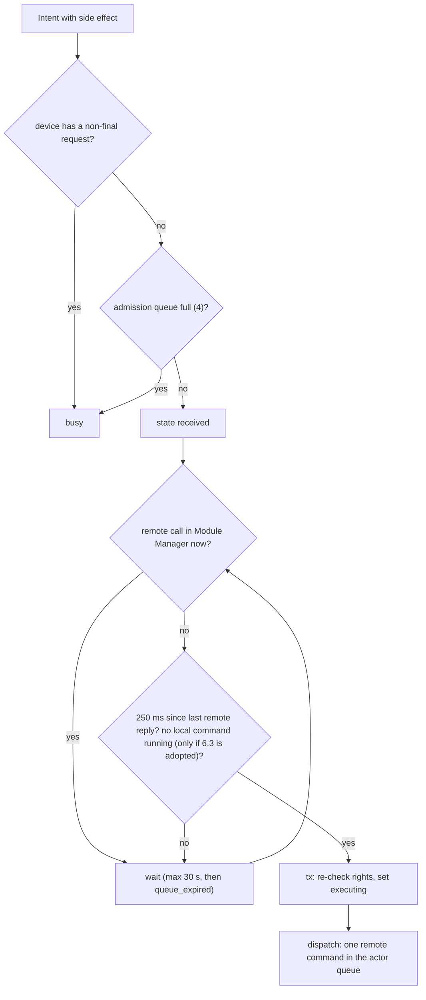

# 08. Сеть, подключение и приоритет локального управления (REV3)

**Статус: PROPOSED.** Закрывает уточнение **C** ТЗ REV3 и находки ревью F-12 (нагрузка на актор), F-14 (интерфейс по умолчанию), F-18 (совместимость версий), F-19 (нагрузка на SQLite). Все числа — начальные предложения [ПРЕДЛ], их нужно замерить в MPA-2.

## 1. Протоколы

| Назначение | Протокол | Статус |
|---|---|---|
| Запрос/ответ | HTTPS (HTTP/1.1 поверх TLS 1.3) + REST/JSON | MVP |
| События, потоковые ответы чата | WebSocket (upgrade на аутентифицированном соединении) | MVP |
| Большие данные | HTTP streaming / ranged GET | отложено |
| Desktop UI | Tauri IPC (без изменений) | существует |
| Синхронизация | Versioned Sync API | отложено; в MVP синхронизации нет [ВЛАДЕЛЕЦ] |

## 2. Режимы связи

| Режим | Как | Статус |
|---|---|---|
| LAN | адреса из QR сопряжения; соединение напрямую | MVP |
| Internet | VPN, выбранный пользователем; для ATLAS это ещё один адрес. TLS и аутентификация ATLAS работают поверх VPN; VPN не считается авторизацией | MVP [ВЛАДЕЛЕЦ: ТЗ 2026-11-20 §4] |
| Собственный relay/rendezvous | только пересылка непрозрачного сквозного TLS; не хранит содержимое | отложено; отдельный ADR (MD-08) [ВЛАДЕЛЕЦ] |
| Проброс порта на роутере | — | не поддерживается |
| Offline | телефон показывает снимок «устарело»; очереди команд нет | MVP [ВЛАДЕЛЕЦ] |
| Обнаружение mDNS/Bonjour | на iOS нужны разрешение Local Network и `NSBonjourServices` [ВНЕШН] | отложено |

## 3. Сетевой интерфейс Desktop по умолчанию (F-14)

| Правило [ПРЕДЛ] | Причина |
|---|---|
| Интерфейса по умолчанию нет: при включении пользователь выбирает адрес из списка локальных частных адресов и адресов VPN | не открывать доступ во все сети |
| Привязки ко всем интерфейсам (`0.0.0.0`, `::`) нет | то же |
| В Windows-профиле сети «Общественная» listener не включается; Desktop показывает предупреждение [ДОПУЩ: как определять профиль через Windows API — проверить в MPA-2] | публичные Wi-Fi |
| Выбранный адрес исчез (смена сети) → listener закрывается, состояние `unavailable` с причиной; при появлении адреса — только по действию пользователя или по явной настройке «включать снова на этом адресе» | без неожиданного открытия |
| Порт настраиваемый; правило брандмауэра Windows создаётся только с согласия пользователя (системный запрос). Отключать защиту не предлагается (`CLAUDE.md`) | безопасность Windows |
| В QR передаётся только выбранный адрес и адрес VPN, если пользователь его указал | минимум сведений о сети |

## 4. Переподключение

Последовательность и правила повторов описаны в документе 02 §5 (классы ошибок) и документе 07 §8.3 (схема). Здесь — только сетевые параметры:

| Параметр | Значение [ПРЕДЛ] |
|---|---|
| Задержка | экспоненциальная 1 → 30 с, джиттер ±20 % |
| После возврата на передний план | немедленная попытка |
| Порядок после соединения | аутентификация → подписка на события → снимок → статусы ожидающих запросов |
| Обнаружение перезапуска Desktop | смена `instance_id` → полная пересинхронизация снимка |

## 5. Версии и совместимость (F-18)

| Правило [ПРЕДЛ] | Пример |
|---|---|
| Версия протокола — целое число; `/api/v1`, WebSocket-подпротокол `atlas.v1` | — |
| Обе стороны сообщают диапазон `{min, max}`; используется наибольшая общая версия; общей нет → `protocol_unsupported` | телефон v1–v2, Desktop v1 → v1 |
| Внутри версии изменения только добавляющие: новые необязательные поля и новые варианты перечислений; клиент обязан игнорировать неизвестное | новый тип события |
| Поддержка старой версии: Desktop поддерживает предыдущую версию не меньше 6 месяцев после выпуска новой [ПРЕДЛ — решение владельца при MPA-4] | задержка обновлений в магазинах |
| Минимальная версия приложения | Desktop может отказать клиентам ниже минимума с понятным сообщением |

## 6. Приоритет локального управления (уточнение C)

### 6.1 Ограничение, которое нельзя менять

Module Manager — один последовательный актор с очередью FIFO (решение 3, ADR-014). Чтения (`modules`, `module`, `plan`, `get_settings`) идут из `watch`-снимка и актор не занимают [КОД: `manager.rs:269–325`]. Через актор проходят `apply`, `update_settings`, `replace_config`, `check_health` [КОД: `manager.rs:342–405`]. Менять очередь менеджера (приоритеты внутри актора) нельзя — это переопределение Module Manager. Поэтому приоритет локального управления обеспечивается **допуском (admission control) в Remote Access**, до очереди менеджера.

### 6.2 Правила допуска

| Правило | Значение [ПРЕДЛ] | Эффект |
|---|---|---|
| Одновременных удалённых вызовов в Module Manager | **1 на весь Desktop** | в очереди актора не больше одной удалённой команды; локальная команда ждёт максимум одну удалённую |
| Пауза между удалёнными вызовами | 250 мс после ответа | локальные команды, пришедшие во время удалённого вызова, встают в очередь раньше следующего удалённого |
| Незавершённых запросов с побочным эффектом на устройство | 1 | второй → `busy` |
| Общая очередь допуска (все устройства) | 4 записи в `received` | переполнение → `busy` |
| Ожидание в очереди допуска | 30 с | дольше → `not_executed(queue_expired)` |
| Окно ожидания подтверждения | challenge 120 с; весь запрос 5 мин | дольше → `not_executed(confirmation_window_expired)` |
| Чтения на устройство | 10 запросов/с, всплеск 20 | `rate_limited` |
| Неаутентифицированные попытки с адреса | 5/мин; сопряжение — 5 неудач на режим | `rate_limited` / закрытие режима |
| WebSocket-соединений на устройство | 2 | старые закрываются |
| Отмена | `DELETE /requests/{id}` для `received` и `awaiting_confirmation` → `not_executed(cancelled_by_client)`; запрос в `executing` не отменяется (06 §6, ADR-014) | — |
| Устаревшие запросы | `module.apply` несёт `acknowledged`; Module Manager сам проверяет план (`impactChanged`, ADR-012) | без дополнительной логики |

### 6.3 Сигнал локальной активности (вариант)

Дополнительно можно ввести счётчик локальных команд с побочным эффектом в тонком слое `commands/` (увеличение до вызова менеджера, уменьшение после). Пока счётчик > 0, Remote Access не диспетчеризует. Это изменение Desktop-кода в рамках задачи Remote Access (MI-07), а не изменение Module Manager. Решение — при MPA-2 [ПРЕДЛ, PENDING OWNER APPROVAL в рамках MD-05].

### 6.4 Худший случай для локального пользователя

Локальная команда ждёт не дольше одной удалённой команды. Её длительность ограничена собственными сроками Module Manager (таймауты операций модулей, ADR-014). При высокой нагрузке с телефонов локальное управление остаётся предсказуемым: удалённые запросы получают `busy` или `queue_expired`, а не занимают очередь актора. Голодания удалённых запросов тоже нет: очередь допуска FIFO с ограниченным ожиданием.

## 7. Нагрузка на SQLite (F-19)

Каждый запрос с побочным эффектом даёт 2–3 транзакции с `synchronous = FULL` на единственном соединении (ADR-016), плюс аудит. Это соединение общее с записью конфигурации модулей. Меры:
- объединять вставку `received` и запись аудита в одну транзакцию;
- для чтений журнала не нужно;
- замер задержки и пропускной способности на Windows — критерий G4 (риск R-17).

Отдельный файл БД отклонён: это второй фундамент хранилища (документ 10, CF-5).
