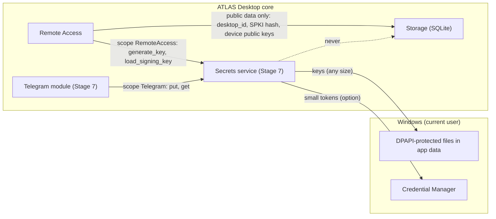

# 09. Интеграция с Secrets (REV3)

**Статус: PROPOSED.** Закрывает **F-04** (часть «контракт») и уточнение **A** ТЗ REV3. Это **контракт и требования** к будущему core-сервису Secrets, а не его реализация. Secrets остаётся на **Stage 7** (`docs/ROADMAP.md:10`: «secure token storage») [ВЛАДЕЛЕЦ: ТЗ REV3 §4 F-04, §6 CF-6]. Сейчас сервиса нет.

## 1. Исходные условия

| Факт | Источник |
|---|---|
| Секреты хранятся в Windows Credential Manager / DPAPI-хранилище или поддерживаемом эквиваленте; не попадают в SQLite в открытом виде, логи, crash reports и экспорт диагностики; в настройках модулей — только ссылка (`token_ref`) | [ДОК] `ARCHITECTURE.md:187–188` |
| Значения настроек не пишутся в журнал, события и `Debug` | [ДОК] ADR-015 (`DECISIONS.md:183`) |
| Stage 7 включает «secure token storage» | [ДОК] `docs/ROADMAP.md:10` |
| Ограничение Credential Manager — ≈2560 байт на запись | [ДОПУЩ] из аудита Stage 0/1; проверить при проектировании Stage 7 |
| `windows-rs` разрешён «по необходимости»; прямой зависимости пока нет | [ДОК] `CLAUDE.md`; [КОД] `src-tauri/Cargo.toml` |

## 2. Что нужно Remote Access

| Потребность | Секрет? | Где хранить |
|---|---|---|
| Приватный ключ TLS Desktop (`dk<n>`) | **да** | Secrets |
| Сертификат Desktop (открытая часть) | нет | рядом с ключом в Secrets — для атомарной ротации [ПРЕДЛ] |
| SPKI-хэш, `desktop_id`, версии ключа | нет | SQLite (реестр) |
| Открытые ключи устройств | нет | SQLite (реестр) |
| Секрет сопряжения (QR) | да, но кратковременный | **только память**, никогда не сохраняется |
| Nonce и challenge | нет (одноразовые) | память; в журнале — хэш challenge |
| Сессии | — | только память; после перезапуска Desktop устройства проходят challenge заново |

**Вывод для сроков:** «secure token storage» из Stage 7 покрывает хранение токенов (Telegram). Remote Access дополнительно нужно **хранилище асимметричного ключа с генерацией и ротацией**. Если Stage 7 этого не включит, нужна отдельная будущая задача «Secrets: хранение ключа для Remote Access» **после Stage 7** (MI-02a, документ 14). Порядок этапов это не меняет. Зависимость явно указана в документах 10 и 11.

## 3. Контракт (проект интерфейса)

```text
// core-сервис, создаётся при старте (ADR-011); выдаётся потребителям как ограниченный дескриптор
SecretsService
  fn scope(&self, owner: SecretOwner) -> SecretScope       // SecretOwner: RemoteAccess | Telegram | ...

SecretScope   // видит только своё пространство имён
  // секреты-значения (токены)
  async fn put(&self, name: &SecretName, value: SecretBytes) -> Result<(), SecretError>
  async fn get(&self, name: &SecretName) -> Result<SecretBytes, SecretError>
  async fn delete(&self, name: &SecretName) -> Result<(), SecretError>
  // асимметричные ключи
  async fn generate_key(&self, name: &KeyName, alg: KeyAlg) -> Result<KeyInfo, SecretError>   // KeyAlg: EcdsaP256
  async fn key_info(&self, name: &KeyName) -> Result<KeyInfo, SecretError>                    // версия, открытый ключ, сертификат
  async fn load_signing_key(&self, name: &KeyName) -> Result<SigningKeyHandle, SecretError>   // ключ в памяти процесса, обнуляется при Drop
  async fn delete_key(&self, name: &KeyName) -> Result<(), SecretError>

SecretError = Unavailable | NotFound | Corrupted | AccessDenied | TooLarge | Io
SecretBytes / SigningKeyHandle: без Debug/Display/Serialize значения; Debug = "***"; zeroize при Drop
```

Имена: `remote_access/desktop_tls/v<n>`; ротация создаёт новую версию, а не перезаписывает текущую.

## 4. Владение жизненным циклом ключа

| Действие | Решает | Выполняет |
|---|---|---|
| Создание первого ключа | Remote Access — при первом включении удалённого доступа пользователем | Secrets `generate_key` |
| Плановая ротация | Remote Access — по действию пользователя или по сроку [ПРЕДЛ: 1 год] | Secrets: новая версия; Remote Access: анонс, окно перекрытия, переключение, удаление старой (05 §6) |
| Экстренная ротация | пользователь на Desktop | то же + отзыв всех устройств |
| Удаление | Remote Access — при «Удалить удалённый доступ» | Secrets `delete_key` |
| Защита хранения | Secrets | DPAPI / Credential Manager |



## 5. Границы доступа

| Компонент | Доступ |
|---|---|
| Remote Access | только `SecretScope(RemoteAccess)`; дескриптор передаётся при создании через `AppState`, глобального поиска нет |
| Telegram (модуль, Stage 7) | только `SecretScope(Telegram)`; передаётся через сервисы для модулей (открытый вопрос ?-2, `claude/ROADMAP_AFTER_MM4.md` Н-2) |
| Прочие модули | нет доступа без отдельного решения |
| WebView, IPC, Remote API | **нет** команд, возвращающих значения секретов; IPC показывает только статус («ключ есть, версия n») |
| Storage | не принимает секретных типов: в API `storage` нет параметров `SecretBytes` [ПРЕДЛ: тест-проверка исходников по образцу границы `sqlx`] |

## 6. Защита от утечки

| Канал | Мера |
|---|---|
| SQLite | секреты не передаются в `storage`; тест исходников; ревью миграций |
| Логи | типы с маскировкой; Remote Access логирует только версии ключей и коды ошибок |
| Crash reports / паники | у типов секретов нет форматирования значений; panic hook (`logging.rs`) печатает сообщения, а не значения |
| Экспорт диагностики (Stage 8) | каталог Secrets и ключи исключены; в экспорте — только состояние |
| Память | `SigningKeyHandle` держит ключ только пока listener открыт; обнуление при закрытии |
| Резервные копии | DPAPI-блобы бесполезны вне профиля пользователя [ДОПУЩ: проверить]; это защита, но и риск потери (§7) |

## 7. Отказы и восстановление

| Ситуация | Поведение Remote Access | Автоматически |
|---|---|---|
| После перезапуска Desktop | `load_signing_key` текущей версии; затем сверка журнала; затем listener | да (обычный запуск) |
| Secrets `Unavailable` (ошибка DPAPI, ввода-вывода) | `unavailable` с причиной; listener не открывается; запасного варианта хранения ключа в открытом виде нет | нет |
| `NotFound` (ключ удалён) | `unavailable`: «Ключ удалённого доступа отсутствует — требуется повторное сопряжение»; новый ключ только по действию пользователя | нет |
| `Corrupted` (не расшифровывается, например другой профиль Windows) | как `NotFound`; старый блоб сохраняется для диагностики, пока пользователь не удалит его | нет |
| Ключ есть, но не совпадает с SPKI в реестре | `unavailable`; рассогласование → экстренная ротация по действию пользователя | нет |

Автоматически новый ключ не создаётся: это аннулирует все сопряжения, а решение принимает пользователь (по образцу ручного восстановления, решение 12).

## 8. Что это значит для сроков (F-04)

| Шаг | Где | Зависит от |
|---|---|---|
| Контракт (этот документ) как входные данные проектирования Stage 7 | MD-03 (документ 14) | решение владельца принять его во внимание |
| Secrets service (токены) | **Stage 7** (утверждено) | Stages 0–6 по порядку |
| Хранение ключа для Remote Access | в составе Stage 7 **или** отдельная задача после Stage 7 (MI-02a) | Stage 7 |
| Remote Access (MPA-2) | новые задачи после G3 | Secrets с ключами |
| Connected Mobile MVP | MPA-4 | MPA-2, MS-03b |

**Connected Mobile MVP не может быть готов раньше, чем появятся нужные возможности Secrets**, то есть раньше завершения Stage 7.
