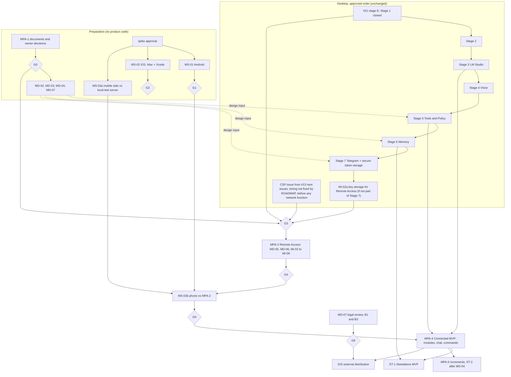

# 11. Roadmap и зависимости реализации (REV3)

**Статус: PROPOSED.** Объединяет REV2 `MULTI_PLATFORM_ROADMAP.md` и `DEPENDENCY_MAP.md`: в ТЗ REV3 это один документ (§11 п. 11). Утверждённый порядок Desktop не меняется: `docs/ROADMAP.md`, этапы 0–9; порядок Module Manager — решение 31.

## 1. Принципы

1. Desktop прежде всего: мобильная работа не переставляет, не задерживает и не меняет состав утверждённых этапов.
2. Архитектурная подготовка (документы, спайки) отделена от реализации (Remote Access, мобильное приложение).
3. Ни одна сетевая функция не сливается до прохождения G3 («security groundwork»).
4. После каждого гейта владелец решает Go/No-Go. No-Go не затрагивает Desktop.
5. Для iOS нужны Mac и полный Xcode. Распространение iOS дополнительно требует G6.
6. Фоновой работы, несовместимой с ограничениями ОС, нет: MVP работает только на переднем плане.

## 2. Утверждённый Desktop-порядок и место MPA

| Desktop (утверждено) | Мобильная работа рядом (без изменения порядка) |
|---|---|
| Stage 1 — завершение #21 этап E | MPA-1 (документы); спайки MS-01, MS-02, MS-03a — по отдельному разрешению |
| Задача CSP (#13 «Следующие issue»; срок в ROADMAP не задан, «до сетевых функций») | — |
| Stage 2 Hybrid UI | — |
| Stage 3 LM Studio | — |
| Stage 4 Voice | — |
| Stage 5 Safe Windows tools (registry, policy, audit) | вход проектирования: `RequestContext` (MD-02) |
| Stage 6 Memory | вход проектирования: поля происхождения (MD-04) |
| Stage 7 Telegram, **secure token storage** | вход проектирования: контракт Secrets (MD-03) |
| (новая задача после Stage 7, если Stage 7 не включит хранение ключа) | MI-02a: хранение ключа для Remote Access |
| — G3 — | MPA-2: Remote Access (новые задачи MI-02…MI-09) |
| Stage 8, 9 | MS-03b, MPA-4, ST-1, MPA-5 — по мере готовности (§3) |

Расположение MPA-2 относительно Stage 8 и 9 — решение владельца о планировании (OD-15). MPA-2 не требует Stage 8 и 9.

## 3. Пересчитанная последовательность (F-04)

**Итог:** при утверждённом порядке Remote Access и Connected Mobile MVP возможны только **после Stage 7**. К тому моменту Stage 3 (чат), Stage 5 (команды) и Stage 6 (история, память) уже выполнены. Поэтому:
- REV2-инкремент MPA-4b («команды после Stage 5») объединён с MPA-4;
- отдельное ожидание Stage 5 больше не нужно;
- перенос памяти в MPA-5 сохраняется только как **сокращение объёма** MVP — по времени он ничего не даёт (подвопрос OD-2).

## 4. Гейты

| Гейт | Когда | Критерии | Выполним сейчас |
|---|---|---|---|
| **G0** | конец MPA-1 | OD, блокирующие G0, приняты (REV3_DECISION_REGISTER §1); CF-1…CF-4 и принцип CF-2 приняты; ADR-017…020 приняты, отклонены или отложены; REV3 без противоречий | **нет**: решений владельца нет |
| **G1** | после MS-01 | ядро и хранилище собраны и тесты storage прошли на Android (эмулятор/устройство); изоляция паник через unwind работает; выбрана линия Tauri | нет (спайк не выполнен); от Desktop не зависит |
| **G2** | после MS-02 | то же для iOS; нужны Mac и Xcode | нет; наличие оборудования неизвестно |
| **G3** | до слияния любого кода с listener | Stage 1 закрыт (#21); CSP задан; Secrets с хранением ключа есть (Stage 7 [+ MI-02a]); OD-14 принят; CF-5 сформулирован после обновления ADR-016 | **нет**: #21 открыт, `csp: null`, Secrets нет |
| **G4** | конец MPA-2 | инварианты I-1…I-12 (документ 04 §5) и тесты журнала (07 §11) зелёные в Windows CI; ручная проверка Windows записана; результаты помечены «проверено на demo-каталоге»; замеры нагрузки SQLite и допуска (08) | нет |
| **G5** | конец MS-03b | прототип на одном Android (и одном iOS, если G2) проходит сопряжение, отзыв, подтверждение, `outcome_unknown`, переподключение; рекомендации OD-6, OD-9 | нет |
| **G6** | до любого внешнего распространения iOS | критерии документа 13 §6 | **нет**: B1, B3 открыты |

## 5. Фазы

| Фаза | Объём | Зависимости | Критерии приёмки | Риски |
|---|---|---|---|---|
| **MPA-1** Архитектурная подготовка | REV3; решения владельца; MD-02, MD-03, MD-04; старт MD-07 | — | G0 | время владельца |
| **MS-01 / MS-02 / MS-03a** Спайки (одноразовые, не сливаются) | сборка ядра и хранилища под Android/iOS; мобильная сторона (TLS с pin в Rust, ключи, биометрия) против локального тестового сервера | разрешение на спайки; для MS-02 — Mac | отчёты; G1, G2 | R-09, R-25, R-29 |
| **MPA-2** Remote Access (Desktop) | MD-05, MD-06, MI-02…MI-09 | G0, G3 | G4 | R-10, R-12, R-17, R-31 |
| **MS-03b** Связанный прототип | телефон против MPA-2 | G4, G1 (+G2), MS-03a | G5 | R-25 |
| **MPA-4** Connected MVP | приложение (OD-6); офлайн-оболочка; сопряжение; модули; чат (Stage 3); команды (Stage 5); UX статусов и `outcome_unknown`; LAN + VPN; только передний план; соответствие требованиям магазинов (документ 13 §5) | G5; Stage 3, Stage 5 (к тому моменту выполнены) | инварианты end-to-end; ручные проверки на эталонных устройствах; Android — по итогам OD-7; **iOS вне G6 — только внутренние сборки** | R-19, R-20, R-23 |
| **ST-1** Standalone MVP | локальный экземпляр, история, адаптер провайдера (OD-11) | MPA-4; G1/G2; Stage 6 | нет заявлений «ассистент» без провайдера; устойчивость к убийству процесса | R-09 |
| **MPA-5** Расширения | история и память Desktop (если не в MVP); ST-2 после MS-04; голос; relay (MD-08); явное копирование и Sync API; mDNS; push (OD-8) | по отдельным решениям | по задачам | R-39 |

## 6. Граф зависимостей задач (из документа 14)

| Задача | Зависит от |
|---|---|
| MD-01 (документы в репозиторий) | G0, OD-1 |
| MD-02 `RequestContext` | OD-14 |
| MD-03 контракт Secrets | — (вход для Stage 7) |
| MD-04 поля происхождения | — (вход для Stage 6) |
| MD-05 спецификация API v1 | G0, OD-5, OD-10 |
| MD-06 проект хранения журнала, реестра, аудита | MD-05, CF-5 (после #21 этап E) |
| MD-07 юридический пакет | OD-7 |
| MD-08 ADR relay | MPA-4 |
| MS-01, MS-02, MS-03a | разрешение на спайки (MS-02: Mac) |
| MS-03b | G4, G1, MS-03a |
| MS-04 | MPA-4, OD-11 |
| MI-01 тест границы `tauri` | отдельное разрешение (только тест) |
| MI-02a хранение ключа Secrets | Stage 7 |
| MI-02 Remote Access | G3, MD-05, MD-06 |
| MI-03 ключ TLS и pinning | MI-02, MI-02a |
| MI-04 реестр, сопряжение, отзыв | MI-03 |
| MI-05 сессии, `RequestContext`, права | MI-04, OD-5, OD-14 |
| MI-06 Request Journal и аудит | MI-05, MD-06 |
| MI-07 REST API v1 и допуск | MI-06, MD-05 |
| MI-08 Event Gateway | MI-05 |
| MI-09 UI управления удалённым доступом | MI-02…MI-05 |
| MI-10 скелет мобильного приложения и CI | G5, OD-6 |
| MI-11 сопряжение, офлайн-оболочка, модули | MI-10 |
| MI-12 чат | MI-11, Stage 3 |
| MI-13 статусы и `outcome_unknown` | MI-06, MI-11 |
| MI-14 команды | MI-11, Stage 5, MD-02 |
| MI-15 история Desktop | Stage 6, OD-2 |
| MI-16 ST-1 | MPA-4, Stage 6, OD-11, OD-13 |
| MI-17 память Desktop | Stage 6, OD-2 |

## 7. Проверка графа

| Проверка | Результат |
|---|---|
| Циклы | нет. Кажущийся цикл «G3 требует CF-5, детали CF-5 в MD-06 внутри MPA-2» снимается так: на G3 нужен только принцип (по образцу MM-5B), конкретные миграции — в MD-06 |
| Недостающие предусловия | добавлены: MI-02a (ключ в Secrets), требования магазинов (13 §5), обновление ADR-016 (#21 E) |
| Неверная последовательность в REV2 | исправлено: «MVP ждёт только Stage 3»; CF-1…CF-4 на G3 при OD-3 на G0; спайки за G0; MS-03 одним блоком; OD-7 в G0 |
| Гейты, невыполнимые сейчас | G0 (решения), G3 (#21, CSP, Secrets), G6 (B1, B3) |
| Независимые задачи | MD-02, MD-03, MD-04, MD-07; MS-01, MS-02, MS-03a (после разрешения) |
| MVP на текущем Desktop | **невозможен**: production-каталог пуст, чата нет, сети, Secrets и CSP нет. Возможна только демонстрация протокола на demo-каталоге (уровень MS-03b) |
